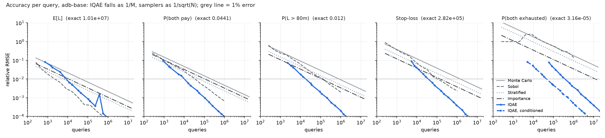

<!-- Generated by docs/build_docs.py from docs/README.template.md and results/*.json. Edit the template, not this file. -->
# Quantum amplitude estimation for joint catastrophe-bond losses

Phase 1 project for the ADB Quantum Innovation Challenge, *Joint-Loss Modelling for Disaster
Risk Financing* (Kyrgyz Republic / Tajikistan disaster relief bond). Proposal draft:
[`docs/proposal.md`](docs/proposal.md).

**Question.** Can quantum methods estimate the joint loss and payout risk of a multi-country
catastrophe-bond portfolio more accurately per query than strong classical samplers, and does
that hold as the portfolio grows?



## Results at a glance

Base scenario, queries to 1% relative RMSE (one query = one sampled term, or one application of A):

| Target | Exact | Best classical (queries) | IQAE (queries) | Ratio |
|---|---:|---:|---:|---:|
| E[L] | USD 10.06m | Sobol, 2.3k | 8.3k | 0.27x |
| P(both pay) | 4.414% | Sobol, 35k | 10k | 3.4x |
| P(L>80m) | 1.205% | importance, 113k | 18k | 6.2x |
| stop-loss | USD 0.28m | Sobol, 105k | 37k | 2.9x |
| P(both exhausted) | 0.0032% | importance, 12.1M | 374k (46k conditioned) | 32x (264x) |

* Across the five scenarios IQAE needs 2.5x-7x fewer queries on the moderate
  targets and 25x-42x fewer on the rare tail; Sobol wins on E[L].
* Exact VaR99 = USD 87.5m, CVaR99 = USD 106.7m (base). CVaR99 moves from USD 97.1m
  (independent) to USD 114.0m (common shock); VaR95 stays at USD 70m.
* On 2-D grids with shared perils, exact computation stops at 4 rows. IQAE keeps
  an edge on a moderate tail (1.6x at 16x16) and loses to importance sampling
  on rarer tails (0.16x).
* Quantum-enhanced MCMC beats local MCMC under high contagion, but Wolff cluster moves beat every
  quantum sampler (the best quantum sampler needs 281x the evaluations).
* Certified IQAE intervals covered the exact value in at least 99.55% of 2,000 runs per cell
  (nominal 99%). Clopper-Pearson misses can be confidently wrong (worst 303%), so the
  digital twin uses Chernoff-Hoeffding bounds (twin worst miss 6%, at 1.60x the queries).
* **Digital twin.** Interval transport saves 23%-30% of the queries on a fine
  shared-quake sweep at 10% half-width; a conditional tail-scenario library moved by exact thinning
  saves 86%; budget allocation cuts weighted error by 46% against a
  difficulty-proportional split. Classical paired MC beats the paired quantum circuit for structure
  choice (28x-43x).
* The Qiskit circuit matches exact values to 2e-13. The full A needs fault tolerance
  (9,322 CX; surface-code estimate up to 8.3e+05 physical qubits and
  53 days for the rarest target at 1%); a 6-qubit sub-circuit is costed at 394 HQC.
  **Nothing has been submitted to hardware.**

Claim level: accuracy per query in noiseless emulation; utility, not advantage. One quantum
query is about 8,272 T gates at n = 2. Negative results are in
[`docs/proposal.md`](docs/proposal.md#6-claim-boundary-and-negative-results).

## Run a portfolio

```bash
python -m adbq run configs/adb-base.yaml        # or: pip install -e . && adbq run configs/*.yaml
python -m adbq validate configs/*.yaml
```

The digital twin (certified answers, a dependence sweep with interval transport, a structure
comparison, and a conditional tail-scenario library with drivers, all with a query ledger):

```bash
python -m adbq twin configs/twin-adb-base.yaml  # writes results/twin_runs/<name>/report.json, summary.md
```

Each run writes `results/runs/<name>/report.json`, `summary.md` and figures. Shipped configs:

| config | model | targets | run time |
|---|---|---|---:|
| `configs/adb-base.yaml` | two_country | E[L], P(both pay), P(L>T), stop-loss, ... | 13 s |
| `configs/adb-common-shock.yaml` | two_country | E[L], P(both pay), P(L>T), stop-loss, ... | 11 s |
| `configs/adb-independent.yaml` | two_country | E[L], P(both pay), P(L>T), stop-loss, ... | 11 s |
| `configs/adb-rain-cover.yaml` | two_country | E[L], P(both pay), P(L>T), stop-loss, ... | 11 s |
| `configs/adb-rain-stress.yaml` | two_country | E[L], P(both pay), P(L>T), stop-loss, ... | 10 s |
| `configs/boltzmann-8x8.yaml` | grid_boltzmann | E[L], P(L>T), VaR95, CVaR95, ... | 0 s |
| `configs/chain-5.yaml` | chain | E[L], P(>=2 pay), P(L>T), stop-loss, ... | 2 s |
| `configs/grid-4x4.yaml` | grid_sources | E[L], P(L>T3), P(L>T5), stop-loss, ... | 39 s |

## What is in here

| module | contents |
|---|---|
| `model.py` | the brief's model; annual CTMC and independent-source routes; Table 5 |
| `baselines.py`, `risk_baselines.py` | MC, Sobol, stratified, importance and loss-tilted samplers with exact variances |
| `circuits.py`, `oracle.py` | gate-level A, exact sparse simulator |
| `qae.py`, `risk_qae.py` | IQAE (Clopper-Pearson or Chernoff-Hoeffding), MLAE; VaR bisection and CVaR with IQAE |
| `risk.py` | exact loss laws (two-country, chain), VaR and CVaR |
| `portfolio.py` | n-country chain and its exact transfer-matrix contraction |
| `grid.py`, `qmcmc.py` | calibrated Ising trigger grid; quantum-enhanced MCMC |
| `twin.py` | the certified portfolio digital twin (`adbq twin`) |
| `_vendor/supplychain_qmcmc` | four modules from the team's earlier project `logistics_under_disruption`, unchanged |
| `gridsources.py`, `grid_estimators.py` | 2-D shared-peril grid, exact sweep, MC / RQMC / tilt / cross-entropy, IQAE |
| `qiskit_circuits.py` | Qiskit A and Q, compiled counts, verification by composition |
| `resources.py` | logical resource model |
| `twin.py` | digital twin: versioned source laws, exact ratio bounds, interval transport, scenario library, paired comparisons, allocation, ledger |
| `pipeline.py`, `cli.py` | `adbq run config.yaml` |

Generated result summaries: [`risk_summary.md`](results/risk_summary.md),
[`grid_summary.md`](results/grid_summary.md), [`qmcmc_exact.md`](results/qmcmc_exact.md),
[`qmcmc_chains.md`](results/qmcmc_chains.md), [`grid_qae.md`](results/grid_qae.md),
[`real_circuits.md`](results/real_circuits.md), [`coverage.md`](results/coverage.md),
[`twin.md`](results/twin.md), [`ft_estimate.md`](results/ft_estimate.md).

## Reproduce

```bash
python -m venv .venv && source .venv/bin/activate     # Windows: .venv\Scripts\activate
pip install -r requirements.txt                       # or requirements-lock.txt for the exact versions used
pytest -q                                             # fast suite; pytest -m slow for the 24-qubit check
python experiments/environment.py                     # records versions and machine -> results/environment.json
python experiments/accuracy_per_query.py              # two-country accuracy per query
python experiments/scaling.py                         # chain scaling and resource model
python experiments/cvar.py                            # exact VaR / CVaR (second implementation)
python experiments/risk_accuracy.py && python experiments/risk_report.py
python experiments/grid_exact.py                      # Ising grid, exact
python experiments/qmcmc_exact.py                     # QeMCMC exact scorecard (3 x 4)
python experiments/qmcmc_chains.py --default          # QeMCMC chains (4 x 4), about an hour
python experiments/grid_qae.py                        # high-width comparison, about an hour
python experiments/real_circuits.py                   # Qiskit / pytket / noisy Aer
python experiments/coverage.py                        # certified-interval coverage
python experiments/twin.py                            # digital-twin experiments
python experiments/twin_intervals.py                  # interval method for the twin (CP vs CH)
python experiments/ft_estimate.py                     # surface-code estimate
python experiments/quantinuum_job.py                  # dry run only: native counts and HQC
python -m adbq run configs/*.yaml                      # twin configs are skipped; use adbq twin
python -m adbq twin configs/twin-adb-base.yaml
python experiments/make_figures.py
python docs/build_docs.py                             # README.md and docs/proposal.md from results
python docs/build_pdf.py                              # docs/proposal.pdf (Windows with Microsoft Word)
python tools/package_submission.py                    # submission ZIP = the files git would publish
```

The repository is self-contained: the QeMCMC track and the Quantinuum helpers use four modules from the
team's earlier project `logistics_under_disruption`, vendored unchanged in `src/adbq/_vendor/` (set
`ADBQ_LOGISTICS_SRC` to use an external checkout instead).

## Environment, hardware and simulators

* **Machine:** 20 logical CPUs, 32 GB memory, Windows 11 (AMD64), Python 3.12.14; no GPU. Measured run times of the heaviest steps are in
  [`docs/proposal.md`](docs/proposal.md#36-classical-compute-and-fit-to-the-timeline).
* **Packages:** NumPy 2.5.1, SciPy 1.18.0, Matplotlib 3.11.1, PyYAML 6.0.3,
  pytest 9.1.1; quantum extras Qiskit 2.5.1, Qiskit Aer 0.17.2, pytket 2.18.4,
  pytket-qiskit 0.77.0, pytket-quantinuum 0.59.1 (exact list:
  `requirements-lock.txt`, written by `experiments/environment.py`).
* **Simulators:** adbq's own exact sparse state-vector simulator (`circuits.py`, no SDK) for every verified
  amplitude; Qiskit Aer for state-vector checks of the Qiskit circuits and for noisy shot simulation with
  published-spec noise models; pytket-quantinuum for offline compilation to the H-series gate set.
* **Quantum hardware:** none used. A small Quantinuum job is compiled and costed (`experiments/quantinuum_job.py`,
  dry run by default) and has not been submitted.
* **Sample outputs:** `results/` (JSON and Markdown summaries, figures, and one folder per pipeline run in
  `results/runs/` and `results/twin_runs/`).

## Assumptions to confirm against ADB's benchmark repository

* Stratified sampling uses proportional allocation across the three strata.
* The brief's importance-sampling proposal tilts by annual principal loss, mixed half-and-half with p.
* The n-country chain and the 2-D grid families are ours; the brief defines only n = 2.

## AI use

Code and documentation were drafted with Claude (Anthropic) and checked against exact references,
independent implementations and the test suite. `README.md` and `docs/proposal.md` are generated by
`docs/build_docs.py`; every number in them comes from `results/`.
