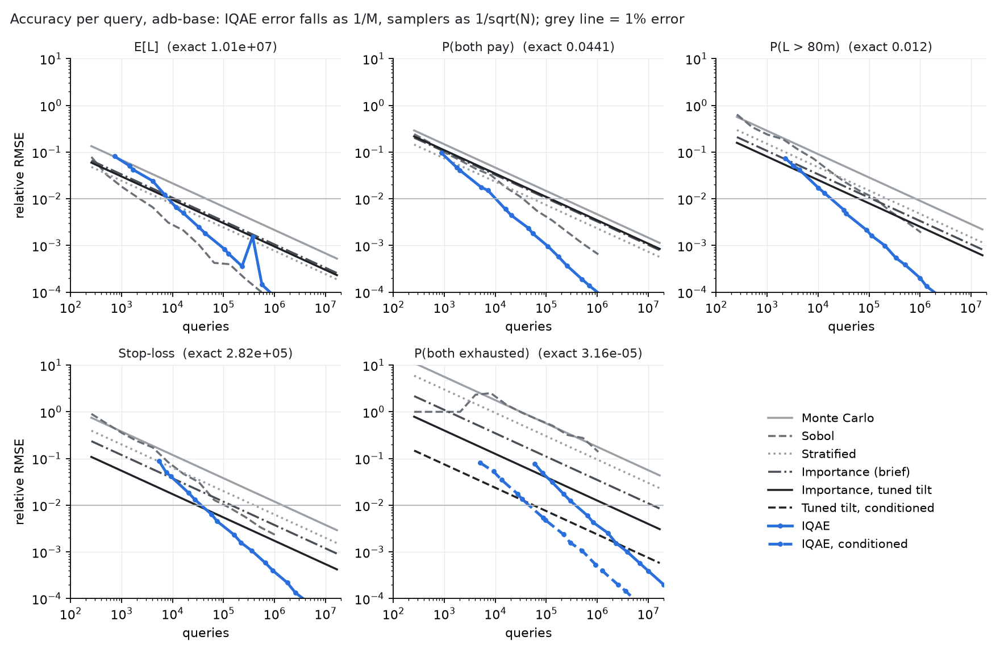
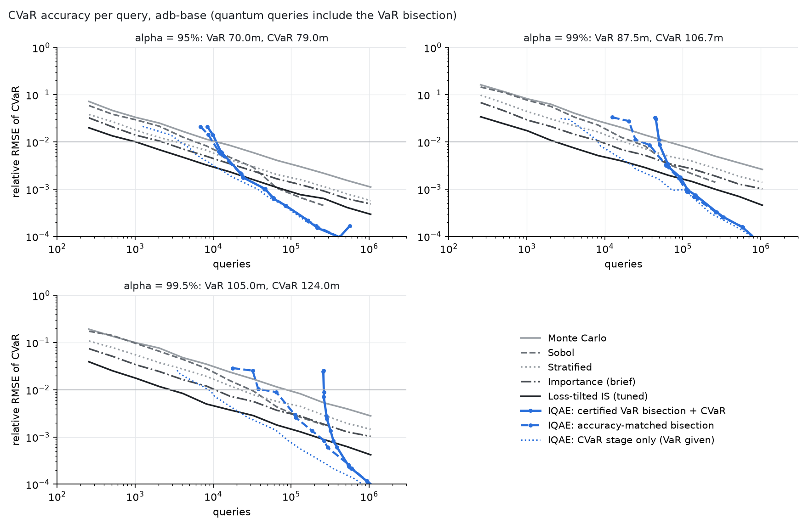
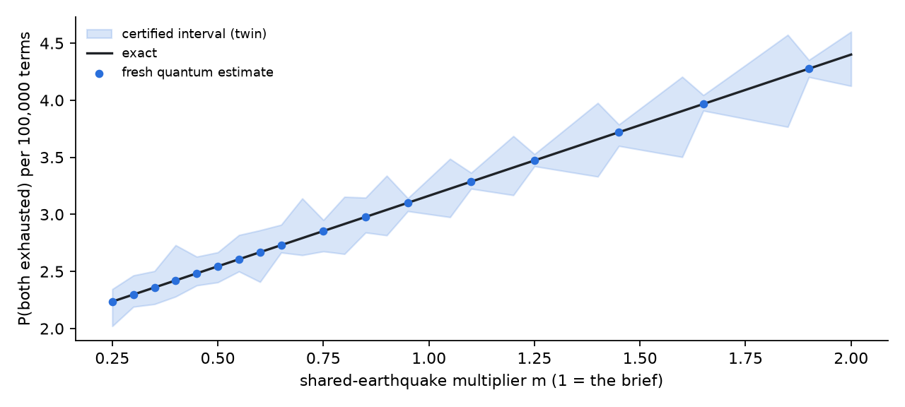
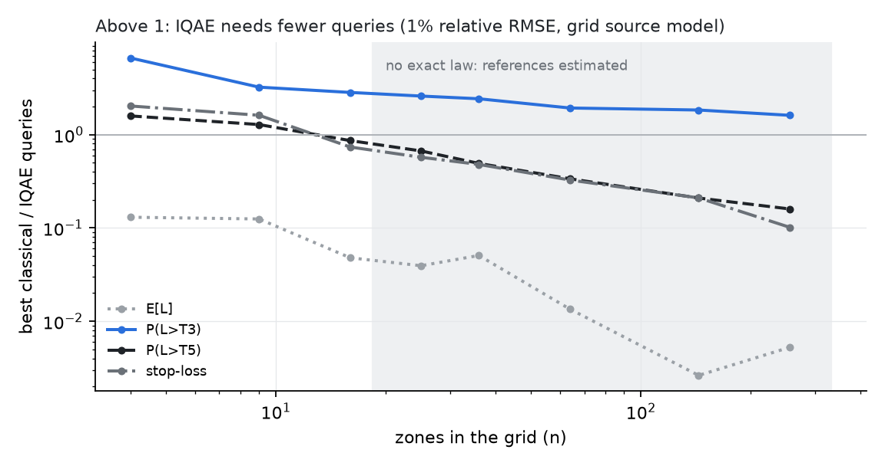

# Certified Quantum Estimation of Joint Catastrophe Tails: a Digital Twin for Disaster Risk Finance

*ADB Quantum Innovation Challenge, Phase 1 technical proposal. Team: Prof. LAU Hoong Chuin (lead) and
Monit Sharma, Singapore Management University. Every result of this prototype is generated from scripts in the
accompanying repository by `docs/build_docs.py`; the template holds no hand-typed results. Figures from the team's
earlier manuscripts (Section 6) are cited, not reproduced; they are kept in `docs/prior_work.json` and marked as
cited where they appear. The five sections required by the application form are Sections 1 to 5.*

## Executive summary

We propose a **certified digital twin of the disaster-risk portfolio**: a versioned model of the bonds that
answers the questions ADB actually asks (how likely the joint tail is, what drives it, how it moves when the
dependence assumptions change, and which contract structure is better), each with a confidence interval that
holds with {{cov_nominal}} probability when the circuit is exact, and a recorded query cost. The twin is classical-first. Its certified estimator is iterative
quantum amplitude estimation (QAE), which we implemented gate by gate, verified against every reference value
in the brief, and benchmarked against strong classical samplers. It builds on the team's earlier work on
amplitude estimation for decisions under risk (CVaR estimation with certify-or-stop thresholds, validated on
IBM quantum hardware) and on lowering the arithmetic cost of quantum pricing circuits (Section 6). The solver
follows the challenge's benchmark interface (joint-loss-baseline) and passes its tolerances on all five ADB
scenarios, with a worst single-run error of {{bm_worst}} of the tolerance.

What the prototype shows, in accuracy per query (one classical query is one sampled three-year term; one
quantum query is one application of the state preparation A):

* **The brief's two-country model.** Against the best classical sampler, including a loss tilt tuned per
  target, QAE needs {{acc_prob_lo}}-{{acc_prob_hi}} fewer queries on the joint-payout and exceedance
  probabilities across all five scenarios. The tuned tilt beats QAE on stop-loss
  ({{acc_stop_lo}}-{{acc_stop_hi}}), and Scrambled Sobol beats it on expected loss ({{acc_el_lo}}-{{acc_el_hi}}).
  On the rarest target, both bonds exhausted ({{exh_p}} per term), QAE needs {{acc_rare_brief_lo}}-{{acc_rare_brief_hi}}
  fewer queries than the brief's own samplers, but rain is independent of earthquakes, so both sides can condition
  on it. With that conditioning on both sides and a tuned tilt, the margin is {{acc_rare_lo}}-{{acc_rare_hi}}.
* **Certified intervals hold.** Clopper-Pearson IQAE intervals covered the exact value in at least
  {{cov_min}} of {{cov_runs}} runs per cell (nominal {{cov_nominal}}). When an interval misses, it is
  narrow and wrong (largest miss {{cov_worst_miss}}), so certification means correct with {{cov_nominal}} probability.
  The twin therefore uses Chernoff-Hoeffding bounds: on the twin's own tasks the worst miss falls from
  {{ti_cp_worst}} to {{ti_ch_worst}}, for {{ti_cost_median}} the queries (Section 2.10).
* **Tail risk.** CVaR99 moves from {{cvar99_indep}} (independent) to {{cvar99_common}} (common shock) while
  VaR95 stays at {{var95_base}}: only a tail measure sees the dependence. For CVaR, a tuned importance sampler
  beats the quantum route at {{cvar_loose}} accuracy; the quantum route wins at {{cvar_tight}}.
* **The twin.** On a fine sweep of the shared-quake multiplier at 10% half-width, interval transport between
  nearby model versions saves {{twin_save_lo}}-{{twin_save_hi}} of the queries ({{twin_save5_lo}}-{{twin_save5_hi}} at 5%), with
  coverage held; on a coarse sweep the controller falls back to recomputing at no meaningful loss. Reusing a library of
  conditional tail scenarios saves {{lib_saving}}. Budget allocation cuts weighted error by {{alloc_vs_prop}}
  against a difficulty-proportional split.
* **Scaling.** Chains of countries are exactly solvable in linear time, so no quantum claim is made there. On
  a 2-D grid where neighbours share peril streams, exact computation stops at {{grid_exact_rows}} rows (the
  nearest-neighbour Ising grid of Section 2.7 is a different model and contracts exactly to {{ising_tm_rows_max}} x {{ising_tm_rows_max}}); beyond it, QAE keeps a lead
  on a moderately rare tail ({{grid_t3_last}} at {{grid_last}}) and loses to importance sampling on rarer tails
  ({{grid_t5_last}}).
* **Hardware.** The circuit is compiled and noise-simulated; the full model needs fault tolerance (order of
  {{ft_worst_qubits}} physical qubits and {{ft_worst_days}} for the rarest target at the tightest accuracy). A
  6-qubit sub-circuit survives realistic noise and is costed at {{hqc_recommended}} HQC; nothing is submitted.

We do not claim a practical quantum advantage on the two-country benchmark: exact enumeration takes well under
a millisecond there. Our claim is **utility with certified answers**, with the scaling question asked where
exact methods fail and with every negative result kept (Section 2.16).

## 1. Problem & Approach

### 1.1 The problem and the current state of the art

The portfolio is two catastrophe bonds, each of principal {{bond_principal}} ({{quake_limit}} earthquake cover
paid in quarter steps, {{rain_limit}} precipitation cover), over a {{term_years}}-year term. Every target is an
expectation of a contract payoff under the joint law of capped term states. The bottleneck is accuracy on rare
joint targets at a fixed budget, not runtime.

Catastrophe models today price such joint tails by Monte Carlo over synthetic event catalogues, with dependence
written as shared events or copulas and variance reduced by quasi-Monte Carlo, stratification and importance
sampling (Glasserman; Joe). Quantum amplitude estimation offers a quadratic reduction in queries for the same
accuracy (Brassard et al.; Montanaro), and has been studied for financial risk (Woerner and Egger; Egger et al.;
Herman et al.), but not, to our knowledge, benchmarked on sovereign catastrophe-bond structures against strong
classical samplers with certified intervals.

**Reproduction.** We reimplemented the brief's exact method twice, independently (the annual CTMC with capped
convolution, and an independent-source form). Both reproduce Table 5 (brief in brackets):

{{table_table5}}

### 1.2 Where classical computation struggles, and where it does not

The three-year term is a product of independent Poisson sources (own quakes per country, shared quakes, own and
shared rain) followed by capped sums; equivalently, the countries are conditionally independent given the shared
events. Both team members found this independently. It makes the quantum state preparation linear in the number
of sources, and it also lets exact classical methods scale much further than the brief suggests:

* **Chains of countries are easy.** A 50-country chain has {{chain_naive_states_nmax}} annual joint states, yet a
  transfer-matrix contraction gives exact targets in {{chain_tm_seconds_nmax}} and the full loss law at n = 50
  (CVaR99 {{chain_cvar99_n50}}) in {{chain_loss_seconds_n50}}.
* **Shared-peril grids are hard.** On a 2-D grid where every neighbouring pair shares quake and rain streams,
  the exact sweep stops at {{grid_exact_rows}} rows for this source model ({{grid_exact_4x4_seconds}} for 4 x 4; a 6 x 6 frontier holds
  {{grid_frontier_6x6}} values). Beyond it only sampling remains.
* **But good importance samplers are strong where the loss is a sum of light-tailed sources.** Their cost
  stays nearly flat as tails get rarer, while QAE pays one over the square root of the probability. The
  bottleneck QAE removes is the one plain Monte Carlo has.

### 1.3 Proposed approach: a certified portfolio twin

The twin is a classical controller around two quantum primitives: QAE estimates how likely a joint-tail event
is, and amplitude amplification samples what it looks like. Every output carries an interval, a query count,
and the model and contract version it belongs to. Its components (Section 2) are certified QAE, tail
decomposition and CVaR, conditional tail scenarios, dependence sweeps with certified reuse, decision-focused
structure comparison, and budget allocation; a second track tests quantum-enhanced MCMC for dependence written
as a Boltzmann law. One portfolio specification drives everything: `adbq run config.yaml` for a portfolio,
`adbq twin twin.yaml` for the twin.

### 1.4 Expected advantage, feasibility and scalability

* **Expected advantage.** Accuracy per query on joint-payout and exceedance probabilities, where QAE needs
  {{acc_prob_lo}}-{{acc_prob_hi}} fewer queries than the best tuned classical sampler on the brief's model,
  with intervals that hold at a stated confidence. On the rarest target the margin over a tuned, conditioned
  sampler is small ({{acc_rare_lo}}-{{acc_rare_hi}}). We state where it does not hold: expectations, stop-loss,
  rare tails of large light-tailed sums, and structure comparison (Section 2.16).
* **Feasibility.** The full state preparation is a fault-tolerant circuit (Section 3); a 6-qubit sub-circuit is
  a realistic near-term hardware experiment; the twin itself runs classically today.
* **Scalability and adaptation.** The loader grows linearly with the number of independent sources, for any
  dependence model written as a forward simulator. The same twin, with a different specification, applies to
  regional pools, other perils, and the team's earlier inventory and supply-chain problems (Section 5).

## 2. Technical Rationale

### 2.1 Certified QAE

Each target becomes an amplitude: indicator targets mark term states; bounded payoffs
(expected loss, stop-loss) are encoded by a controlled rotation. We use iterative QAE (Grinko et al.) with
the failure budget split over the schedule, so every reported interval holds with the stated confidence
whenever the circuit is exact. IQAE needs no quantum Fourier transform, so it uses shallower circuits than
canonical phase estimation. The per-round bounds can be Clopper-Pearson (fewer queries) or
Chernoff-Hoeffding (more conservative). The twin uses {{ti_method}}: it carries anchor intervals across many
model versions, so a confidently wrong anchor would spread through a sweep (Section 2.10).

### 2.2 Tail decomposition and CVaR

Stop-loss is the exceedance probability times the conditional mean excess;
CVaR follows from the Rockafellar-Uryasev form. VaR is located by bisection over the discrete loss levels with
QAE on the CDF indicator, using the team's certify-or-stop rule (the failure budget is split over bisection
steps and reruns; each probe stops at the earlier of certification
and the accuracy the objective needs; in the newsvendor study this cut classical threshold samples by a median
of {{pw_cos}} and kept quantum probes to at most {{pw_probe}} of all calls).

### 2.3 Conditional tail scenarios

Amplitude amplification returns exact samples of three-year histories in
which, for example, both bonds are exhausted, showing what drives the joint tail. Each sample costs about
{{lib_q_per_sample}} quantum queries at the brief's exhaustion probability, against {{lib_classical_per_sample}}
classical scenarios by rejection. The library is labelled as conditional, never as a frequency, and is only as
good as the model.

### 2.4 Dependence sweeps with certified reuse

The shared-event multiplier and the shared-rain share are
poorly constrained by history, so the twin sweeps them. Between two versions the likelihood ratio is exactly
computable source by source, without touching the joint state space. An interval [L, U] for a non-negative
target at one version transports to [r_lo L, r_hi U] at the next with no new queries; cached conditional
scenarios are re-weighted by exact thinning. The controller looks ahead along the sweep (the bounds are free to
compute), chooses how precisely to calibrate, and recalibrates only when a transported interval is too wide.

### 2.5 Decision-focused structuring

ADB chooses structures, not just prices. Two structures are compared on
the same loaded distribution by estimating the difference of their payoffs in one circuit (amplitude one half
plus the mean difference over twice its range), so shared losses cancel; certify-or-stop decides the sign,
with the failure budget split over its rounds so that a wrong sign has probability at most the stated level in
total. On
hardware, centred and mirrored sign tests cancel a shared device offset (newsvendor study: correct order in all
{{pw_runs}} executions on {{pw_device}}).

### 2.6 Budget allocation

Queries are spread across targets and scenarios by priority and difficulty: with
QAE error falling as a difficulty constant over the number of queries, the weighted squared error is minimised
by queries proportional to the cube root of weight times difficulty squared.

### 2.7 A second track for dependence written as a Boltzmann law

When dependence over many peril zones is
specified as a maximum-entropy Ising model, the law cannot be sampled forward and MCMC is needed. We tested
quantum-enhanced MCMC (Layden et al.) on such a model against strong classical samplers (Section 2.15).

### 2.8 Benchmarks

Every quantum result is compared at equal budget with the strongest classical methods we could build, and with
exact values wherever they exist:

* **Exact references:** the brief's CTMC method, an independent-source form, transfer-matrix contractions for
  chains and grids, and full enumeration for the Ising model.
* **Classical samplers:** Monte Carlo, scrambled Sobol and randomized QMC, the brief's stratified and importance
  samplers, exponential tilting tuned by pilot variance, cross-entropy importance sampling, and a loss-tilted
  sampler for CVaR tuned with the exact answer; pilot and adaptation costs are counted and every importance
  sampling cost is validated by independent repeats. The brief leaves the stratified budget split and the
  exact proposal mix open; equal and Neyman (variance-optimal) allocation and tilt weights from {{bs_mix_lo}}
  to {{bs_mix_hi}} move the best-classical-to-IQAE ratio by at most {{bs_max_shift}}
  (`experiments/baseline_sensitivity.py`).
* **Classical MCMC:** local, pair and plaquette moves, Wolff clusters, random jumps and parallel tempering.
* **Quantum alternatives:** maximum-likelihood QAE, two interval rules for IQAE, and quantum-enhanced MCMC
  with a mismatched-landscape control.

### 2.9 Results: accuracy per query, two-country model (base scenario, 1% relative RMSE)

{{table_accuracy_base}}

### 2.10 Results: certified intervals

Clopper-Pearson IQAE, base scenario, {{cov_runs}} emulated runs per cell. At equal realised error it needs
{{cp_saving_median}} fewer queries than the Chernoff-Hoeffding variant (range {{cp_saving_lo}}-{{cp_saving_hi}}):
a modest saving; the point is validity. Where the realised error exceeds the half-width, it is driven by
the rare runs whose interval misses, which is the failure the confidence level allows. A miss is not a near
miss: the interval is narrow and confidently wrong. The largest miss in these runs was {{cov_worst_miss}} of the
exact value ({{cov_worst_miss_cell}}), so a certified answer should be read as correct with {{cov_nominal}}
probability, not as an error bound that always holds.

{{table_coverage}}

**Interval method for the twin.** The same comparison on the twin's own tasks (dependence sweeps with
transport, certified answers, structure ranking; `experiments/twin_intervals.py`). Chernoff-Hoeffding removes
the confidently wrong answers (worst miss {{ti_cp_worst}} with Clopper-Pearson, {{ti_ch_worst}} with
Chernoff-Hoeffding; wrong structure rankings: {{ti_cp_wrong}} and {{ti_ch_wrong}} respectively, of {{ti_sign_total}}) at
{{ti_cost_lo}}-{{ti_cost_hi}} the queries (median {{ti_cost_median}}). The twin uses {{ti_method}}; every twin
query count in Section 2.12 is for that method.

{{table_twin_intervals}}

### 2.11 Results: VaR and CVaR

{{table_var_cvar}}

A small CDF gap means the quantile sits close to an atom, so any estimator needs fine resolution to identify
VaR. Queries for CVaR in the base scenario:

{{table_cvar_queries}}

### 2.12 Results: the digital twin

**Dependence sweeps** ({{twin_reps}} repetitions per row; every point certified; coverage against exact values):

{{table_twin_sweep}}

On the fine sweep of the shared-quake multiplier ({{twin_m_points}} versions) at 10% half-width, transport
saves {{twin_save_lo}}-{{twin_save_hi}}. At 5% half-width it saves {{twin_save5_lo}}-{{twin_save5_hi}}: the window for transport is narrower. On the coarse shared-rain grid each step changes the law too much to transport, so the controller
recomputes (within {{twin_rain_save_absmax}} of the baseline). Lowest coverage in any row: {{twin_cov_min}}.

**Conditional tail scenarios.** A library of {{lib_n}} exact conditional samples of 'both bonds exhausted',
moved from m = 1 to m = 2 by exact thinning, keeps {{lib_kept}} of its samples per step and saves {{lib_saving}}
of the queries against regenerating; driver shares read from it stay within {{lib_max_err}} of the exact
shares. What drives exhaustion: shared quakes alone exhaust both quake covers in {{drv_shared_m1}} of the
scenarios at m = 1 and {{drv_shared_m2}} at m = 2; each country's own quakes do it in {{drv_own_m1}} and
{{drv_own_m2}}; a shared storm triggers both rain covers in {{drv_rain_m1}}.

**Structure choice.** How to split each bond's principal between earthquake and rain cover (exact, base scenario):

{{table_splits}}

Average loss barely moves and VaR99 cannot separate the first three splits; CVaR and stop-loss rank all six.
Certifying the stop-loss order of neighbouring splits:

{{table_structures}}

The paired circuit needs {{paired_gain_lo}}-{{paired_gain_hi}} fewer queries than two separate certified
estimates. **Classical paired Monte Carlo with common random numbers needs {{crn_win_lo}}-{{crn_win_hi}} fewer
scenarios than the paired circuit** (normal approximation, not certified): on this model structure comparison is
classically easy, because the payoff differences come from moderately likely events.

**Budget allocation** over 25 certified queries (5 targets x 5 scenarios, tail targets weighted higher): the
optimal split lowers weighted squared error by {{alloc_vs_equal}} against an equal split and {{alloc_vs_prop}}
against a split proportional to difficulty.

The twin runs as `adbq twin configs/twin-adb-base.yaml` ({{twin_run_seconds}}): certified answers, a sweep, a
structure comparison and a tail-scenario library with drivers, all with a query ledger.

### 2.13 Results: the challenge's benchmark interface

`team_solver.py` follows the evaluator interface of the challenge's benchmark package (joint-loss-baseline) and
writes its submission format, with the run identifier, seed, model evaluations and quantum evidence. On all five
ADB scenarios every target passes its tolerance; the worst single-run error is {{bm_worst}} of the tolerance (the evaluator scores RMSE over repeats). Each run
takes {{bm_sec_lo}}-{{bm_sec_hi}}, at most {{bm_shots}} shots and {{bm_evals_lo}}-{{bm_evals_hi}} oracle queries
in emulation (`results/benchmark_submission/`). The package scores measured process time against the fastest
classical method, including the exact solver, so on the two-country model it confirms correctness, not speed.

### 2.14 Results: high-width grid (best classical / IQAE queries at 1%; above 1 favours IQAE)

{{table_grid_qae}}

### 2.15 Results: quantum-enhanced MCMC on a Boltzmann dependence model

Exact, 3 x 4 (steps to 10% CVaR95 error, each sampler at its best tilt):

{{table_qmcmc_exact}}

Sampled chains, 4 x 4, {{qmcmc_chains}} chains per sampler, {{qmcmc_budget}} loss evaluations:

{{table_qmcmc_chains}}

Wolff cluster moves beat every quantum sampler; under high contagion the best quantum sampler needs
{{qmcmc_k4_quantum_needs}} the evaluations.

### 2.16 Claim boundary and negative results

* **Accuracy per query, not wall-clock.** One quantum query is a fault-tolerant circuit of {{ft_t_per_query}} T
  gates; one classical query is microseconds.
* **Noiseless emulation, not hardware.** IQAE is emulated shot by shot at the exact amplitude of the verified
  circuit, which is valid for any correct A.
* **Assumptions to confirm with ADB's benchmark repository:** the stratified allocation and the form of the
  brief's loss tilt. The chain and grid families are ours.

Negative results, kept in the record:

1. Importance-tilted loading cannot raise a QAE amplitude (each source ratio bound is at least one).
2. Maximum-likelihood QAE with a doubling schedule aliases on the rarest target.
3. Chain portfolios are exactly solvable in linear time.
4. On shared-peril grids, tilted and cross-entropy importance sampling beat QAE on rare tails and averages at scale.
5. The VaR search dominates the quantum CVaR cost at moderate accuracy.
6. Quantum MCMC proposals lose to Wolff cluster moves at equal budget.
7. Classical paired Monte Carlo beats the paired quantum circuit for structure choice on this model.
8. Interval transport pays only when consecutive model versions are close.
9. The full A is not a near-term hardware circuit.
10. On the brief's model a loss tilt tuned per target beats QAE on stop-loss ({{acc_stop_lo}}-{{acc_stop_hi}}).
    On the rarest target, the brief's importance sampler is far from the best classical estimator: conditioning
    on the independent rain triggers and tilting the earthquake steps brings it within {{acc_rare_lo}}-{{acc_rare_hi}}
    of conditioned QAE. The tilt parameter is tuned on the exact variance, which favours the classical side by
    at most a short pilot run.

## 3. Resource Estimation

### 3.1 Circuit design and verification

**Loader.** A loads each independent source on its own register with a Grover-Rudolph tree, computes capped
totals with reversible saturating adders, and rotates an objective qubit by the payoff. It grows linearly with
the number of sources and stays linear for any dependence model that can be written as a forward simulator,
while exact inference does not. A conditioned loader (rain register restricted to a cheap necessary event of
probability {{cond_prefactor}}) raises the exhaustion amplitude {{cond_amplitude_gain}}.

**Verification ladder.** Exact sparse simulator (all amplitudes match the exact targets) -> Qiskit translation
(errors {{qiskit_full_A_err}} on A, {{qiskit_grover_err}} on Q^k A) -> compiled library arithmetic (checked on
every source configuration, {{qiskit_chain_mismatches}} mismatches) -> noisy simulation -> costed hardware plan.

### 3.2 Cost of one query

Compiled with Qiskit (chain circuit for P(L > T); the analytic model is a lower bound):

{{table_compiled}}

### 3.3 Qubits, depth, two-qubit gates and shots per certified answer

One certified answer runs IQAE: rounds of {{shots_per_round}} shots of Q^k A with growing Grover power k. Per
application of A (two countries, compiled): {{ft_logical}} logical qubits, {{cx_per_query}} two-qubit gates, depth
{{depth_per_query}}, {{ft_t_per_query}} T gates. The deepest circuit in a run is Q^k A at the largest k used.
IQAE with {{ti_method}} bounds at {{cov_nominal}} confidence:

{{table_quantum_resources}}

### 3.4 Fault-tolerant cost

Surface code, physical error rate one in a thousand, {{ft_factories}} distillation factories, one-microsecond
code cycle; rules of thumb in `experiments/ft_estimate.py`, to be replaced by a full estimator (for example
Azure Quantum Resource Estimator or Qualtran) in the Deep Development phase:

{{table_ft}}

**Query counts, corrected.** The idealised count one over (epsilon times the square root of p) gives
{{ideal_q_exh_10}} oracle calls for 10% accuracy on the exhaustion target. Measured IQAE with certified 99%
intervals needs {{measured_q_exh_10}}, {{measured_over_ideal}} the idealised count. The width is a guarantee:
the realised error is {{exh_target_over_rmse}} smaller than the target half-width (Section 2.10). Plain Monte Carlo
needs {{mc_exh_10}} scenarios for a 10% root-mean-square error on average, without a guarantee.

**Where the T gates go, and how we will cut them.** The compiled count is {{compiled_over_model}} the analytic
model. Its {{tof_n2}} Toffolis account for only about {{tof_t_share}} of the T gates; the rest is rotation
synthesis for the {{rot_n2}} arbitrary-angle rotations of the loaders and the payoff rotation. The Deep
Development estimate will follow the method of the team's own resource paper (Sharma and Lau, *Reducing the
arithmetic cost of quantum derivative pricing*), which goes beyond the derivative-pricing benchmark of
Chakrabarti et al.: on that benchmark's windowed TARF payoff it cut Toffoli count times peak logical qubits
{{ar_tarf}} ({{ar_tarf_tof}} Toffolis and {{ar_tarf_q}} qubits, against {{ar_ref_tof}} and {{ar_ref_q}} for the
lookup reference), and {{ar_auto}} on a factor-sum autocallable, with every circuit checked on {{ar_holdout}}
held-out paths. That paper costs the reversible payoff arithmetic only; here we add state loading, the payoff
rotation and amplitude estimation, so the estimate covers a full certified answer. On the brief's additive
payout the arithmetic is small, so the main lever now is cheaper loading and rotation; on the layered triggers
and reinstatements of Work Package 3 the payoff arithmetic grows, and the paper's constructions apply directly.

### 3.5 Near-term hardware, error mitigation and modality

Under published-spec noise models the full two-country A ({{full_A_cx}} CX) has a probability of
no gate error per application of {{full_A_p_ok_h2}} (H2-1 model) to {{full_A_p_ok_helios}} (Helios-1 model), so
it is a fault-tolerant circuit. A 6-qubit rain sub-circuit recovers its amplitude within a few percent under
noise; a job for it is compiled and costed ({{hqc_recommended}} HQC, {{hw_shots}} shots per circuit) and not
submitted. The team's IBM Kingston experience sets the near-term limit: shallow Grover amplification kept
contrast {{pw_c_short}} at {{pw_g_short}} two-qubit gates and fell to {{pw_c_long}} at {{pw_g_long}}. Mitigation
for a demonstration: readout-assignment correction, dynamical decoupling, Pauli twirling, contrast-calibrated
amplitude estimation and mirrored sign tests.

{{table_noisy}}

**Hardware modality.** Near term: trapped ions (all-to-all connectivity avoids routing overhead for the
multi-controlled loaders and adders; highest published two-qubit fidelities), with superconducting devices for
the shallow sub-circuits the team has already run on IBM hardware. Long term: any error-corrected platform; the
estimate above assumes a surface code.

### 3.6 Classical compute and fit to the timeline

All prototype results were produced on one workstation ({{env_cpu_line}}, no GPU) with the versions in
`requirements-lock.txt`; no quantum hardware was used. Measured times of the heaviest steps:

{{table_classical_compute}}

The Deep Development work fits the timeline: every experiment reruns in hours on one workstation, and the
QAI Ventures Sandbox (QCentroid with Phoenix compute) adds GPU state-vector and tensor-network simulation for
the larger loaders in Work Package 1. A hardware demonstration needs only the costed sub-circuit.

## 4. Work Plan

### 4.1 Milestones (Deep Development, 30 November 2026 to 22 January 2027)

| Dates | Milestone | Output |
|---|---|---|
| 30 Nov - 6 Dec | Sandbox onboarding; reproduce every result on the Sandbox; confirm benchmark settings and datasets with ADB and mentors | Reproduction report; settings agreed |
| 7 - 20 Dec | WP1 Validate circuits: GPU and tensor-network simulation of full loaders; compiled cost reduction | Gate G1 (20 Dec): coverage and compiled cost within the resource model |
| 14 Dec - 3 Jan | WP2 Adaptive engine: the twin as a service on ADB's portfolio configurations | Gate G2 (3 Jan): certified answers reproduce exact references |
| 21 Dec - 10 Jan | WP3 Scale-up study: overlapping footprints and non-additive payouts, five to ten countries | Gate G3 (10 Jan): a target class where QAE beats the best classical sampler per query, or the regime where it does not |
| 5 - 17 Jan | WP4 Hardware demonstration (after approval) and full fault-tolerant estimate | Hardware result for the sub-circuit; resource report |
| 18 - 22 Jan | Final submission package | Working prototype, technical documentation, classical bottleneck analysis, business case |
| 25 Jan | Final pitch | Presentation and live demo of the twin |

### 4.2 Work packages and go/no-go gates

Four work packages, each ending in a go/no-go gate. If the scale-up gate fails, we report the regime where
classical methods win, which is itself evidence for ADB.

1. **Validate circuits.** GPU statevector and tensor-network simulation of the full loaders and payoff blocks at
   the largest size the QAI Ventures credits allow; certified coverage on all target-scenario queries. Compiled
   T counts reduced towards the analytic model (cheaper adders, fewer rotations). *Gate: coverage and compiled
   cost within the resource model.*
2. **Adaptive engine.** The twin as a service: dependence sweeps over the earthquake multiplier and rain share,
   certified reuse, paired structuring, budget allocation, a full query ledger, and ADB's own portfolio
   configurations. *Gate: certified answers reproduce the exact references wherever they exist.*
3. **Scale-up study.** With ADB, extend the model to overlapping fault systems, footprint-correlated event sizes
   and non-additive payouts (layered and parametric triggers with reinstatements), for five to ten countries,
   where exact inference is intractable and good importance samplers are hard to build. Compare against Monte
   Carlo, Sobol, stratified, tuned and cross-entropy importance sampling, and tensor-network approximations.
   *Gate: a target class where QAE beats the best classical sampler per query.*
4. **Deliver.** A hardware demonstration on a reduced instance (the costed sub-circuit first, after approval),
   a full fault-tolerant estimate built on the team's arithmetic-cost method (Sharma and Lau, *Reducing the
   arithmetic cost of quantum derivative pricing*; Section 3.4), extended from payoff arithmetic to loading,
   rotation and amplitude estimation and cross-checked with a standard estimator, the final report, documented
   code and a demo of the twin on ADB's portfolio.

### 4.3 Risks, failure points and fallbacks

| Risk or failure point | Likelihood | Fallback or alternative |
|---|---|---|
| No target class where QAE beats the best classical sampler at scale (Gate G3 fails) | Medium | Report the crossover regime as the result; the twin still delivers certified, ledgered answers classically, and the quantum route is costed for later hardware |
| Simulation capacity too small to verify full-size loaders | Medium | Verification by composition (loaders by state vector, arithmetic as a classical permutation), tensor networks, and the largest instance that fits |
| Hardware noise destroys the amplified signal, or access is delayed | High for deep circuits | Run only the shallow sub-circuit; noisy simulation with device models; contrast calibration and mirrored tests |
| ADB's benchmark settings or data differ from our assumptions | Medium | Settings are configuration parameters; the pipeline reruns every result from the new settings |
| Compiled T counts stay far above the analytic model | Medium | Report both; apply the team's arithmetic constructions, measurement-based uncomputation, cheaper adders and fewer rotations; quote the remaining gap as Phase 3 work |
| A certified interval is confidently wrong | Low, bounded by the confidence level | Chernoff-Hoeffding bounds in the twin, coverage audits against exact values, the query ledger |
| Team capacity over the holiday period | Medium | WP1 and WP2 first; WP3 scope reduced if needed; documentation generated from results automatically |

## 5. Commercialization & Impact Considerations

The product is a **certified tail-risk twin for disaster risk finance**: useful on classical hardware from day
one, quantum-accelerated where coherent access pays off. For each deal or portfolio it returns joint-tail
metrics with confidence intervals, a conditional library of tail scenarios showing what drives joint payouts,
a sensitivity band over the dependence assumptions history cannot pin down, and a ranked comparison of
candidate structures, all from one portfolio specification (`adbq run`, `adbq twin`).

**Integration with existing workflows.** The twin sits after the catastrophe model: it takes the model's event
rates or exceedance tables, the dependence assumptions and the contract terms (attachment, sub-limits, payout
steps) as a YAML specification, and returns a JSON report, figures and a summary that feed pricing, structuring
and monitoring. It does not replace the vendor catastrophe model; it adds certified joint-tail answers, a
dependence sensitivity band and a structure ranking on top of it.

**Deployment.** A Python package with a command-line interface, a test suite and generated reports; it runs on
a workstation or in a cloud environment such as the QAI Ventures Sandbox, with quantum back-ends added as they
mature. Portfolio data stay with the user; nothing needs to leave the organisation for the classical path.

**Users.** ADB's disaster risk finance teams first; then issuers and arrangers of sovereign catastrophe bonds and
parametric covers, regional risk pools, reinsurers, and catastrophe-model vendors who could embed the engine.
**Route to market.** Built around ADB's portfolio in Phase 2, then offered as a classical-first library and
service with quantum back-ends as hardware matures; SMU's licensing route and the team's venture experience
support a spin-out or licence. **Other fields.** Pandemic and health-system preparedness, inventory and supply
chains under tail risk, credit portfolios with correlated defaults, and climate stress testing.

## 6. Team and prior work

* **Prof. LAU Hoong Chuin (lead and principal investigator)**, Professor of Computer Science, Singapore
  Management University; Changjiang Scholar. Research in AI and quantum methods for optimisation under
  uncertainty. Founder of Horaion.AI, a venture built on SMU-licensed AI technology. *Role:* scientific
  direction, review of every go/no-go gate, liaison with ADB and the mentors, and the business case and route to
  market (Section 5).
* **Monit Sharma**, School of Computing and Information Systems, SMU. *Role:* technical lead. Built this
  prototype end to end (verified circuits, classical benchmarks, the twin, the benchmark-interface solver and the
  pipeline) and leads Work Packages 1 to 4: circuit validation on the Sandbox, the adaptive engine, the scale-up
  study and the fault-tolerant estimate. First author of the team's amplitude-estimation, quantum-MCMC and
  arithmetic-cost papers below, including the IBM and Quantinuum hardware runs.

| Prior work | What it contributes here |
|---|---|
| Quantum-enhanced simulation-based optimisation for newsvendor problems (Sharma, Lau, Raymond, IEEE QCE 2024) | QAE inside a simulation-based decision loop, verified against classical optimisation |
| Quantum Monte Carlo methods for the newsvendor problem with multiple unreliable suppliers (Sharma and Lau, 2024) | Risk preferences and correlated supply failures estimated with QAE |
| Risk-averse newsvendor decisions with quantum amplitude estimation (Sharma and Lau, manuscript under review) | CVaR via QAE, certify-or-stop thresholds, in-circuit paired comparisons, the complete adaptive procedure run on {{pw_device}} |
| Reducing the arithmetic cost of quantum derivative pricing with language-model circuit design (Sharma and Lau, 2026) | Toffoli times qubit cost of payoff arithmetic cut {{ar_auto}}-{{ar_tarf}} against matched references on the Chakrabarti et al. benchmark; the basis of our fault-tolerant estimate (Section 3.4) |
| Quantum-enhanced MCMC for semiconductor supply-chain stress testing (Sharma and Lau, ongoing) | Quantum-enhanced MCMC kernels for correlated disruptions, with a Quantinuum Helios-1 campaign; the kernels of Section 2.7 are vendored from it |
| Securing the flow: maritime energy security under chokepoint disruptions (Sharma and Lau, 2026) | Geographically correlated, decision-dependent disruptions modelled classically |
| A comparative study of quantum optimisation techniques (Sharma and Lau, 2025) | The same rule as here: compare against strong classical solvers on quality, speed and scaling |

These papers state their limits openly: none claims a runtime advantage over the best classical method on its
demonstration problems. Figures from them are cited, not reproduced here. A separate team profile with short CVs
accompanies the application.

## 7. AI-use statement

Code, experiments and this document were drafted with Claude (Anthropic) under the team's direction and checked
against exact references, independent implementations and the test suite. Every number is generated by scripts
in the repository; the template contains no results.

## 8. References

* ADB Quantum Challenge, Quantum Approaches to Joint-Loss Modelling for Natural Catastrophe Risk, challenge description.
* ADB, ADB issues inaugural disaster relief bonds targeting earthquake and extreme precipitation risk.
* Brassard, Hoyer, Mosca, Tapp (2002). Quantum amplitude amplification and estimation. Contemporary Mathematics 305.
* Montanaro (2015). Quantum speedup of Monte Carlo methods. Proc. R. Soc. A 471.
* Grinko, Gacon, Zoufal, Woerner (2021). Iterative quantum amplitude estimation. npj Quantum Information 7.
* Suzuki et al. (2020). Amplitude estimation without phase estimation. Quantum Information Processing 19.
* Woerner, Egger (2019). Quantum risk analysis. npj Quantum Information 5.
* Egger, Garcia Gutierrez, Cahue Mestre, Woerner (2021). Credit risk analysis using quantum computers. IEEE Transactions on Computers 70.
* Chakrabarti et al. (2021). A threshold for quantum advantage in derivative pricing. Quantum 5.
* Herman et al. (2023). Quantum computing for finance. Nature Reviews Physics 5.
* Grover, Rudolph (2002). Creating superpositions that correspond to efficiently integrable probability distributions. arXiv:quant-ph/0208112.
* Gidney (2018). Halving the cost of quantum addition. Quantum 2.
* Ross, Selinger (2016). Optimal ancilla-free Clifford+T approximation of z-rotations. Quantum Information and Computation 16.
* Fowler, Mariantoni, Martinis, Cleland (2012). Surface codes: towards practical large-scale quantum computation. Physical Review A 86.
* Litinski (2019). A game of surface codes. Quantum 3.
* Rockafellar, Uryasev (2002). Conditional value-at-risk for general loss distributions. Journal of Banking and Finance 26.
* Clopper, Pearson (1934). The use of confidence or fiducial limits illustrated in the case of the binomial. Biometrika 26.
* Glasserman (2003). Monte Carlo Methods in Financial Engineering. Springer.
* Owen (1997). Scrambled net variance for integrals of smooth functions. Annals of Statistics 25.
* Rubinstein, Kroese (2004). The Cross-Entropy Method. Springer.
* Joe (2014). Dependence Modeling with Copulas. CRC Press.
* Wolff (1989). Collective Monte Carlo updating for spin systems. Physical Review Letters 62.
* Layden et al. (2023). Quantum-enhanced Markov chain Monte Carlo. Nature 619.
Team's own work:

* Sharma, Lau, Raymond (2024). Quantum-enhanced simulation-based optimization for newsvendor problems. Proceedings of IEEE QCE 2024. arXiv:2403.17389.
* Sharma, Lau (2024). Quantum Monte Carlo methods for newsvendor problem with multiple unreliable suppliers. arXiv:2409.07183.
* Sharma, Lau (2025). A comparative study of quantum optimization techniques for solving combinatorial optimization benchmark problems. arXiv:2503.12121.
* Sharma, Lau (2026). Securing the flow: strategic storage and corridor design for maritime energy security under chokepoint disruptions. arXiv:2605.11990.
* Sharma, Lau (2026). Reducing the arithmetic cost of quantum derivative pricing with language-model circuit design. arXiv:2611.04431.
* Sharma, Lau. Risk-averse newsvendor decisions with quantum amplitude estimation: threshold accuracy and hardware evidence. Manuscript under review.
* Sharma, Lau. Quantum-enhanced stress testing for semiconductor supply-chain resilience. Ongoing project.
