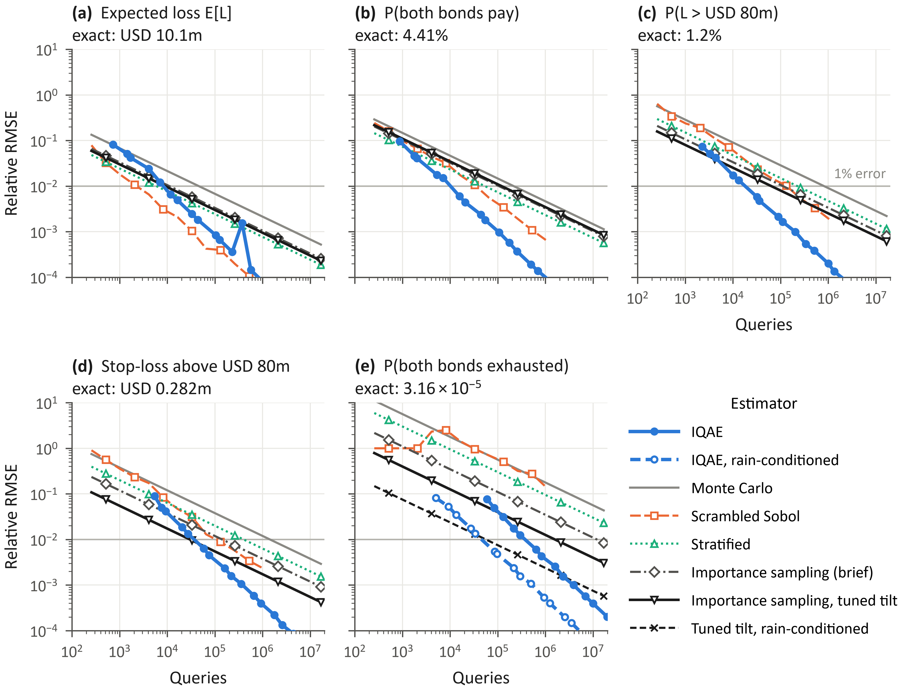
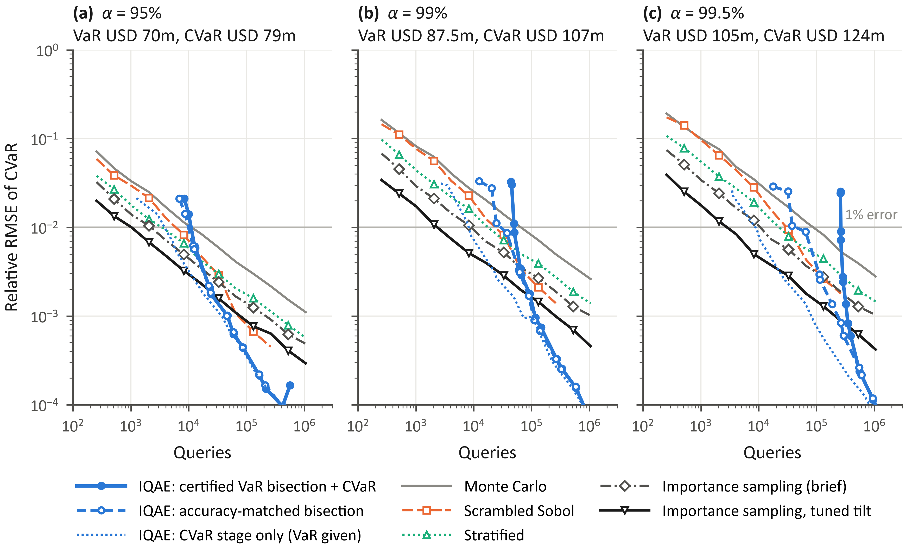
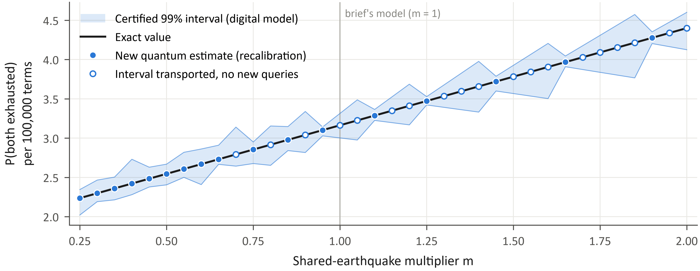
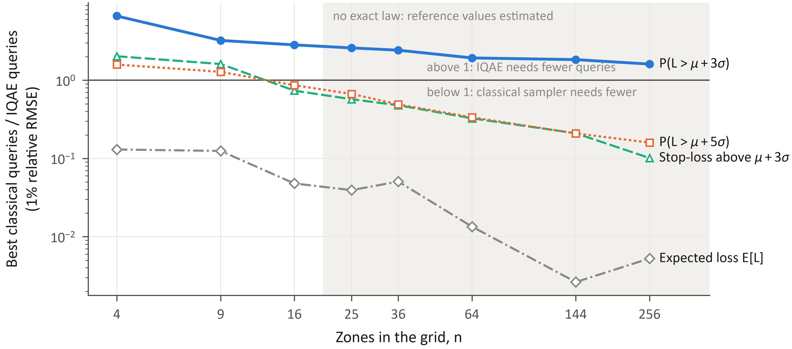

# Certified Quantum Estimation of Joint Catastrophe Tails: a Digital Model for Disaster Risk Finance

*ADB Quantum Innovation Challenge, Phase 1 technical proposal. Team: Prof. LAU Hoong Chuin (lead) and
Monit Sharma, Singapore Management University.*

## Executive summary

We propose a **certified digital model of ADB's disaster-risk portfolio**. It is a versioned model of the bonds
that answers the questions ADB asks: how likely a joint tail event is, what drives it, how it moves when the
dependence assumptions change, and which contract structure is better. Every answer comes with a confidence
interval that holds with {{cov_nominal}} probability and a record of what it cost to compute. The digital model
runs classically today. Its certified estimator is iterative quantum amplitude estimation (QAE), which we built
gate by gate and verified against every reference value in the brief. The work builds on the team's earlier
research on amplitude estimation for decisions under risk, validated on IBM quantum hardware, and on reducing
the arithmetic cost of quantum pricing circuits (Section 6).

The main results, measured in accuracy per query (one classical query is one sampled three-year term; one
quantum query is one application of the state preparation A):

* **The brief's two-country model.** We reproduce Table 5 exactly for all five scenarios, with two independent
  implementations. QAE needs {{acc_prob_lo}}-{{acc_prob_hi}} fewer queries than the best tuned classical sampler
  on the joint-payout and exceedance probabilities, in every scenario. On the rarest target, both bonds exhausted
  ({{exh_p}} per term), the margin over a sampler that also conditions on the independent rain triggers is
  {{acc_rare_lo}}-{{acc_rare_hi}}.
* **Tail risk.** CVaR99 rises from {{cvar99_indep}} without dependence to {{cvar99_common}} under a common shock,
  while VaR95 stays at {{var95_base}}, so only a tail measure sees the dependence. At {{cvar_tight}} accuracy
  the quantum route beats the best classical sampler on {{cvar_tight_wins}}.
* **The digital model.** On a fine sweep of the shared-earthquake multiplier, reusing certified intervals
  between nearby model versions saves {{twin_save_lo}}-{{twin_save_hi}} of the queries without losing coverage.
  Reusing a library of tail scenarios saves {{lib_saving}}, and spreading the query budget by priority cuts
  weighted error by {{alloc_vs_prop}}.
* **Scaling.** On a 2-D grid where neighbouring countries share peril streams, exact computation stops at
  {{grid_exact_rows}} rows. Beyond that, QAE keeps a lead on a moderately rare tail ({{grid_t3_last}} at
  {{grid_last}}). Work Package 3 tests the payoffs where we expect that lead to hold (Section 1.4).
* **Hardware.** The full circuit needs a fault-tolerant machine. A 6-qubit sub-circuit has been compiled,
  simulated with realistic noise and costed at {{hqc_recommended}} HQC (Quantinuum hardware credits) for a
  near-term demonstration.

Exact enumeration of the two-country benchmark takes well under a millisecond, so our claim there is
**useful, certified answers**, not speed. We ask the scaling question where exact methods fail, and Section 2.14
sets out where classical methods win.

## 1. Problem & Approach

### 1.1 The problem and the current state of the art

The portfolio is two catastrophe bonds, each with principal {{bond_principal}} ({{quake_limit}} of earthquake
cover paid in quarter steps and {{rain_limit}} of precipitation cover), over a {{term_years}}-year term. Every
target is the expected value of a contract payoff over the joint distribution of the capped term states. The
hard part is accuracy on rare joint events at a fixed budget, not running time.

Catastrophe models today price such joint tails by Monte Carlo over synthetic event catalogues. Dependence is
written as shared events or copulas, and variance is reduced with quasi-Monte Carlo, stratification and
importance sampling (Glasserman; Joe). Quantum amplitude estimation needs quadratically fewer queries for the
same accuracy (Brassard et al.; Montanaro) and has been studied for financial risk (Woerner and Egger; Egger et
al.; Herman et al.). To our knowledge it has not been benchmarked on sovereign catastrophe-bond structures
against strong classical samplers with certified intervals.

**Reproduction.** We implemented the brief's exact method twice, independently: once as the annual Markov chain
with capped convolution, and once in a form built from independent loss sources. Both reproduce Table 5 (the
brief's values in brackets):

{{table_table5}}

### 1.2 Where classical computation struggles, and where it does not

Over the three-year term, losses come from independent Poisson sources (each country's own earthquakes, shared
earthquakes, and own and shared rain), which are then summed and capped. Put another way, the two countries are
independent once the shared events are known. This keeps the quantum state preparation linear in the number of
sources. It also lets exact classical methods go much further than the brief suggests:

* **Chains of countries are easy.** A 50-country chain has {{chain_naive_states_nmax}} annual joint states, yet a
  transfer-matrix contraction gives exact targets in {{chain_tm_seconds_nmax}}, and the full loss distribution at
  n = 50 (CVaR99 {{chain_cvar99_n50}}) in {{chain_loss_seconds_n50}}.
* **Shared-peril grids are hard.** On a 2-D grid where every pair of neighbours shares earthquake and rain
  streams, the exact method stops at {{grid_exact_rows}} rows ({{grid_exact_4x4_seconds}} for 4 x 4; a 6 x 6 grid
  would need {{grid_frontier_6x6}} stored values). Beyond that, only sampling is left.
* **Good importance samplers are strong when the loss is a sum of light-tailed sources.** Their cost stays nearly
  flat as the tail gets rarer, while QAE pays one over the square root of the probability. QAE removes the
  bottleneck of plain Monte Carlo, not of every classical method.

### 1.3 Proposed approach: a certified digital model of the portfolio

The digital model is a classical controller built around two quantum tools: QAE estimates how likely a joint
tail event is, and amplitude amplification draws examples of what it looks like. Every output records its
interval, its query count, and the model and contract version it belongs to. Section 2 describes the parts:
certified QAE, tail decomposition and CVaR, tail scenarios, dependence sweeps that reuse certified answers,
structure comparison, and budget allocation. A side study of quantum-enhanced MCMC is in Appendix A. One
portfolio specification drives everything: `adbq run config.yaml` for a portfolio and `adbq twin twin.yaml` for
the digital model.

We call it a digital model rather than a digital twin. The user moves it between versions of the model and the
contract, but it does not yet take in observations from the live bonds, such as events, triggers hit or
remaining sub-limits. Reusing intervals between versions is the step that would let it re-certify cheaply when
such data arrive.

### 1.4 Expected advantage, feasibility and scalability

* **Expected advantage.** On the brief's model, QAE needs {{acc_prob_lo}}-{{acc_prob_hi}} fewer queries than the
  best tuned classical sampler on joint-payout and exceedance probabilities, with intervals that hold at a stated
  confidence. Both sides are compared at the same realised root-mean-square error, and the QAE runs use the same
  Chernoff-Hoeffding interval rule as the digital model, so the ratio needs no discount for the product's more
  conservative intervals. On the rarest target, the margin over a tuned, conditioned sampler is small
  ({{acc_rare_lo}}-{{acc_rare_hi}}). The advantage does not hold for expected values, stop-loss, rare tails of large
  light-tailed sums, or structure comparison (Section 2.14).
* **Where the advantage should hold at scale.** On the shared-peril grid, the QAE lead on a moderately rare tail
  shrinks from {{grid_t3_first}} to {{grid_t3_last}} as the grid grows, and importance sampling wins on rarer
  tails (Section 2.13). Light-tailed additive losses are the best case for importance sampling, because one
  exponential tilt fits the whole tail. Work Package 3 targets the cases where a single tilt breaks down: layered
  triggers, reinstatements, and tails that can be reached through several different combinations of events. The
  number of QAE queries depends on how rare the target is, not on the shape of the payoff (the payoff arithmetic
  does add circuit cost per query; Section 3.4), so we expect the QAE lead to hold there. Gate G3 tests this
  hypothesis.
* **Feasibility.** The full state preparation needs a fault-tolerant computer (Section 3). A 6-qubit sub-circuit
  is a realistic near-term hardware experiment, and the digital model itself runs classically today.
* **Scalability and adaptation.** The circuit grows linearly with the number of independent sources, for any
  dependence model that can be written as a forward simulation. With a different specification, the same digital
  model applies to regional pools, other perils, and the team's earlier inventory and supply-chain problems
  (Section 5).

## 2. Technical Rationale

### 2.1 Certified QAE

Each target is turned into an amplitude. Probability targets mark the term states where the event happens;
bounded payoffs such as expected loss and stop-loss are encoded with a controlled rotation. We use iterative QAE
(Grinko et al.) and split the failure budget across its rounds, so every reported interval holds with the stated
confidence whenever the circuit is exact. Iterative QAE needs no quantum Fourier transform, so its circuits are
shallower than those of standard phase estimation. Each round can use Clopper-Pearson bounds (fewer queries) or
Chernoff-Hoeffding bounds (more conservative). The digital model uses {{ti_method}} bounds: it carries anchor
intervals across many model versions, and a confidently wrong anchor would spread through a whole sweep
(Section 2.9).

### 2.2 Tail decomposition and CVaR

Stop-loss is the exceedance probability times the expected excess beyond the threshold, and CVaR follows from the
Rockafellar-Uryasev formula. We find VaR by bisection over the discrete loss levels, using QAE on the cumulative
probability at each step. The search uses the team's certify-or-stop rule: the failure budget is split across
bisection steps and reruns, and each probe stops as soon as it is certified or has reached the accuracy the
decision needs. In the newsvendor study this cut classical threshold samples by a median of {{pw_cos}} and kept
quantum probes to at most {{pw_probe}} of all calls.

### 2.3 Conditional tail scenarios

Amplitude amplification returns exact samples of three-year histories in which, for example, both bonds are
exhausted, which shows what drives the joint tail. At the brief's exhaustion probability each sample costs about
{{lib_q_per_sample}} quantum queries, against {{lib_classical_per_sample}} classical scenarios by rejection
sampling. The library is always labelled as conditional, never as a frequency, and it is only as good as the
model behind it.

### 2.4 Dependence sweeps with certified reuse

History says little about the shared-event multiplier or the shared-rain share, so the digital model sweeps
them. Between two model versions, the likelihood ratio can be computed exactly, source by source, without
touching the joint state space. An interval [L, U] for a non-negative target at one version therefore carries
over to [r_lo L, r_hi U] at the next version with no new queries, and stored tail scenarios are re-weighted by
exact thinning. The controller looks ahead along the sweep (the bounds cost nothing to compute), decides how
precisely to calibrate, and runs QAE again only when a carried-over interval becomes too wide.

### 2.5 Decision-focused structuring

ADB chooses structures, not only prices. To compare two structures, we estimate the difference of their payoffs
in a single circuit on the same loaded distribution, so the losses they share cancel out. Certify-or-stop then
decides which is larger, with the failure budget split across its rounds so that the chance of a wrong answer
stays within the stated level overall. On hardware, centred and mirrored sign tests cancel a shared device
offset; in the newsvendor study they gave the correct order in all {{pw_runs}} executions on {{pw_device}}.

### 2.6 Budget allocation

Queries are spread across targets and scenarios according to priority and difficulty. Because QAE error falls
as a difficulty constant divided by the number of queries, the weighted squared error is smallest when each
target receives queries in proportion to the cube root of its weight times its difficulty squared.

### 2.7 Benchmarks

Every quantum result is compared, at equal budget, with the strongest classical methods we could build, and
with exact values wherever they exist:

* **Exact references:** the brief's Markov-chain method, the independent-source form, and transfer-matrix
  contractions for chains and grids.
* **Classical samplers:** Monte Carlo; scrambled Sobol and randomised quasi-Monte Carlo; the brief's stratified
  and importance samplers; exponential tilting tuned on pilot runs; cross-entropy importance sampling; and, for
  CVaR, a loss-tilted sampler tuned with the exact answer. Pilot and tuning costs are counted, and every
  importance-sampling cost is checked with independent repeats.
* **Agreement with the challenge's benchmark package.** We compared our stratified and importance samplers with
  the published copy of the package (joint-loss-baseline). The importance sampler uses the same proposal, an
  even mix of the annual distribution and the same distribution weighted by annual principal loss. The stratified
  sampler uses the same strata, defined by the first year with a payout. The one difference is that the package
  splits the stratified budget equally across strata, while we split it by stratum weight. Equal and Neyman
  (variance-optimal) splits, and mix weights from {{bs_mix_lo}} to {{bs_mix_hi}}, change the
  best-classical-to-QAE ratio by at most {{bs_max_shift}} (`experiments/baseline_sensitivity.py`).
* **Quantum alternatives:** maximum-likelihood QAE, and two interval rules for iterative QAE.

### 2.8 Results: accuracy per query, two-country model (base scenario, 1% relative RMSE)

{{table_accuracy_base}}

QAE here uses Chernoff-Hoeffding bounds, the same rule as the digital model, and both sides are judged by their
realised error, so the ratios compare like with like.

*A note on query counts for P(both exhausted) at 1%.* Three counts for this target appear in this proposal,
each correct for its own definition: {{exh_q_rmse}} queries for a 1% relative RMSE (this table, error averaged
over runs); {{exh_q_cp_hw}} for a certified 99% interval of 1% half-width with Clopper-Pearson bounds
(Section 2.9); and {{exh_q_ch_hw}} for the same certified interval with the Chernoff-Hoeffding bounds the digital
model uses (Section 3.3). A certified half-width is a guarantee on every run rather than an average error, so it
needs more queries.

*Figure 1. Accuracy per query on the brief's two-country model (base scenario): relative RMSE against the number of queries for each target (a-e), on log-log axes. IQAE (blue) falls as one over the number of queries; the classical samplers fall as one over its square root. The horizontal line marks 1% relative error. One classical query is one sampled three-year term; one quantum query is one application of the state preparation A.*

### 2.9 Results: certified intervals

The table below uses Clopper-Pearson bounds on the base scenario, with {{cov_runs}} emulated runs per cell. At
equal realised error, Clopper-Pearson needs {{cp_saving_median}} fewer queries than Chernoff-Hoeffding (range
{{cp_saving_lo}}-{{cp_saving_hi}}). The saving is modest; what matters is whether the intervals are valid. Where
the realised error is larger than the half-width, it comes from the rare runs whose interval misses, which is
the failure the confidence level allows. Such a miss is not a near miss: the interval is narrow and confidently
wrong. The largest miss in these runs was {{cov_worst_miss}} of the exact value ({{cov_worst_miss_cell}}). A
certified answer should therefore be read as correct with {{cov_nominal}} probability, not as an error bound that
always holds.

{{table_coverage}}

**Choosing the interval rule for the digital model.** We ran the same comparison on the digital model's own tasks:
dependence sweeps with reused intervals, certified answers, and structure ranking
(`experiments/twin_intervals.py`). Chernoff-Hoeffding removes the confidently wrong answers. The worst miss is
{{ti_cp_worst}} with Clopper-Pearson and {{ti_ch_worst}} with Chernoff-Hoeffding, and the number of wrong
structure rankings out of {{ti_sign_total}} is {{ti_cp_wrong}} and {{ti_ch_wrong}} respectively. This costs
{{ti_cost_lo}}-{{ti_cost_hi}} the queries (median {{ti_cost_median}}). The digital model uses {{ti_method}}
bounds, and every query count in Section 2.11 is for that rule.

{{table_twin_intervals}}

### 2.10 Results: VaR and CVaR

{{table_var_cvar}}

A small gap in the cumulative distribution means the quantile sits close to a jump, so any estimator needs fine
resolution to pin down VaR. Queries needed for CVaR in the base scenario:

{{table_cvar_queries}}

*Figure 2. CVaR accuracy per query at three confidence levels (base scenario). The quantum query counts include the VaR bisection; the dotted blue line shows the CVaR stage alone, with VaR given. The horizontal line marks 1% relative error.*

### 2.11 Results: the digital model

**Dependence sweeps** ({{twin_reps}} repetitions per row; every point certified; coverage checked against exact
values):

{{table_twin_sweep}}

On the fine sweep of the shared-earthquake multiplier ({{twin_m_points}} versions) at 10% half-width, reusing
intervals saves {{twin_save_lo}}-{{twin_save_hi}} of the queries. At 5% half-width it saves
{{twin_save5_lo}}-{{twin_save5_hi}}, because a tighter interval can be carried over fewer steps. On the coarse
shared-rain grid, each step changes the distribution too much for reuse, so the controller recomputes, at a cost
within {{twin_rain_save_absmax}} of the baseline. The lowest coverage in any row is {{twin_cov_min}}.

*Figure 3. Dependence sweep of P(both bonds exhausted) over the shared-earthquake multiplier m, at 10% relative half-width. The shaded band is the certified 99% interval; filled markers are new quantum estimates, and open markers are versions whose interval was transported from the last estimate without new queries. The exact value lies inside the band at every version.*

**Tail scenarios.** We built a library of {{lib_n}} exact samples of histories in which both bonds are
exhausted, and moved it from m = 1 to m = 2 by exact thinning. It keeps {{lib_kept}} of its samples per step and
saves {{lib_saving}} of the queries compared with regenerating it, and the driver shares read from it stay within
{{lib_max_err}} of the exact shares. As for what drives exhaustion: shared earthquakes alone exhaust both
earthquake covers in {{drv_shared_m1}} of the scenarios at m = 1 and {{drv_shared_m2}} at m = 2; each country's
own earthquakes do so in {{drv_own_m1}} and {{drv_own_m2}}; and a shared storm triggers both rain covers in
{{drv_rain_m1}}.

**Structure choice.** How each bond's principal is split between earthquake and rain cover (exact values, base
scenario):

{{table_splits}}

Average loss barely moves, and VaR99 cannot tell the first three splits apart, but CVaR and stop-loss rank all
six. Certifying the stop-loss order of neighbouring splits:

{{table_structures}}

The paired circuit needs {{paired_gain_lo}}-{{paired_gain_hi}} fewer queries than two separate certified
estimates. **Classical paired Monte Carlo with common random numbers, however, needs {{crn_win_lo}}-{{crn_win_hi}}
fewer scenarios than the paired circuit** (using a normal approximation, without certification). On this model,
structure comparison is easy classically, because the payoff differences come from moderately likely events.

**Budget allocation** over 25 certified estimates (5 targets in each of 5 scenarios, with tail targets weighted
higher): the optimal split lowers weighted squared error by {{alloc_vs_equal}} compared with an equal split, and
by {{alloc_vs_prop}} compared with a split in proportion to difficulty.

The command `adbq twin configs/twin-adb-base.yaml` runs the whole digital model in {{twin_run_seconds}}: certified
answers, a sweep, a structure comparison and a tail-scenario library with its drivers, all with a ledger of
queries.

### 2.12 Results: the challenge's benchmark interface

`team_solver.py` follows the evaluator interface of the challenge's benchmark package (joint-loss-baseline) and
writes its submission format, including the run identifier, seed, model evaluations and quantum evidence. On all
five ADB scenarios every target passes its tolerance, and the worst single-run error is {{bm_worst}} of the
tolerance (the evaluator scores RMSE over repeated runs). Each run takes {{bm_sec_lo}}-{{bm_sec_hi}}, with at most
{{bm_shots}} shots and {{bm_evals_lo}}-{{bm_evals_hi}} oracle queries in emulation
(`results/benchmark_submission/`). The package scores measured run time against the fastest classical method,
including the exact solver, so on the two-country model it confirms correctness, not speed.

### 2.13 Results: high-width grid (best classical / IQAE queries at 1%; above 1 favours IQAE)

{{table_grid_qae}}

**How the reference values are estimated.** Up to {{grid_exact_rows}} rows the loss distribution is computed
exactly. From {{grid_first_est}} upwards, each reference value is a tilted importance-sampling estimate from a
million loss evaluations, with the second moment (which sets the classical variance) taken from a further run a
fifth of that size. The relative standard error of every reference is at most {{grid_ref_se_max}}. Both query
counts in a ratio scale with the reference, so an error this small moves a ratio by far less than the precision
shown in the table. Every importance-sampling cost is also checked with independent repeats, and any estimator
whose mean misses the reference is marked as failed.

*Figure 4. Best classical queries divided by IQAE queries at 1% relative RMSE on the 2-D shared-peril grid, against the number of zones. Above 1, IQAE needs fewer queries. In the shaded region the loss distribution cannot be computed exactly and reference values are estimated.*

### 2.14 Claim boundary and negative results

* **Accuracy per query, not running time.** One quantum query is a fault-tolerant circuit of {{ft_t_per_query}}
  T gates; one classical query takes microseconds.
* **Noiseless emulation, not hardware.** QAE is emulated shot by shot at the exact amplitude of the verified
  circuit, which is valid for any correct state preparation.
* **A certified interval can be confidently wrong.** With Clopper-Pearson bounds, coverage was at least
  {{cov_min}} of {{cov_runs}} runs per cell (nominal {{cov_nominal}}), but a miss is narrow and wrong: the
  largest was {{cov_worst_miss}} of the exact value. A certified answer is correct with {{cov_nominal}}
  probability; it is not an error bound that always holds. This is why the digital model uses Chernoff-Hoeffding
  bounds, which cut the worst miss on its own tasks from {{ti_cp_worst}} to {{ti_ch_worst}} at {{ti_cost_median}}
  the queries (Section 2.9).
* **Baselines.** The stratified and importance samplers follow the challenge's benchmark package, except for the
  stratified budget split, which changes no ratio (Section 2.7). The chain and grid families are our own.

We keep the negative results on record:

1. Loading the state with an importance tilt cannot raise a QAE amplitude, because each source's ratio bound is
   at least one.
2. Maximum-likelihood QAE with a doubling schedule aliases on the rarest target.
3. Chain portfolios can be solved exactly in linear time.
4. On shared-peril grids, tilted and cross-entropy importance sampling beat QAE on rare tails and on averages at
   scale.
5. The VaR search dominates the quantum cost of CVaR at moderate accuracy.
6. Quantum-enhanced MCMC proposals lose to classical Wolff cluster moves at equal budget, needing up to
   {{qmcmc_k4_quantum_needs}} the evaluations under high contagion (Appendix A).
7. Classical paired Monte Carlo beats the paired quantum circuit for choosing a structure on this model.
8. Reusing intervals pays off only when consecutive model versions are close.
9. The full state preparation is not a near-term hardware circuit.
10. On the brief's model, a loss tilt tuned per target beats QAE on stop-loss ({{acc_stop_lo}}-{{acc_stop_hi}}).
    On the rarest target, the brief's importance sampler is far from the best classical estimator: conditioning
    on the independent rain triggers and tilting the earthquake steps brings it within
    {{acc_rare_lo}}-{{acc_rare_hi}} of conditioned QAE. The tilt is tuned on the exact variance, which favours
    the classical side by at most the cost of a short pilot run.

## 3. Resource Estimation

### 3.1 Circuit design and verification

**State preparation.** A loads each independent source into its own register with a Grover-Rudolph tree, adds
up the capped totals with reversible saturating adders, and rotates an objective qubit by the payoff. It grows
linearly with the number of sources, and stays linear for any dependence model that can be written as a forward
simulation, whereas exact inference does not. A conditioned version, which loads the rain register restricted to
a cheap necessary event of probability {{cond_prefactor}}, raises the exhaustion amplitude by {{cond_amplitude_gain}}.

**Verification.** We checked the circuit in stages. An exact sparse simulator matches every amplitude to the
exact targets. The Qiskit translation agrees to within {{qiskit_full_A_err}} on A and {{qiskit_grover_err}} on
the amplified circuits. The compiled library arithmetic was checked on every source configuration, with
{{qiskit_chain_mismatches}} mismatches. We then ran noisy simulations and costed a hardware job.

### 3.2 Cost of one query

Compiled with Qiskit (chain circuit for P(L > T); the analytic model is a lower bound):

{{table_compiled}}

### 3.3 Qubits, depth, two-qubit gates and shots per certified answer

A certified answer runs iterative QAE: rounds of {{shots_per_round}} shots of the amplified circuit, with the
Grover power k growing from round to round. Each application of A (two countries, compiled) uses
{{ft_logical}} logical qubits, {{cx_per_query}} two-qubit gates, depth {{depth_per_query}} and {{ft_t_per_query}}
T gates. The deepest circuit in a run is the one at the largest k. Iterative QAE with {{ti_method}} bounds at
{{cov_nominal}} confidence:

{{table_quantum_resources}}

### 3.4 Fault-tolerant cost

We assume a surface code with a physical error rate of one in a thousand, {{ft_factories}} distillation
factories and a one-microsecond code cycle. The rules of thumb are in `experiments/ft_estimate.py`; in the Deep
Development phase we will replace them with a full estimator such as the Azure Quantum Resource Estimator or
Qualtran.

{{table_ft}}

**Query counts in practice.** The idealised count, one over (epsilon times the square root of p), gives
{{ideal_q_exh_10}} oracle calls for 10% accuracy on the exhaustion target. Measured iterative QAE with certified
99% intervals needs {{measured_q_exh_10}}, which is {{measured_over_ideal}} the idealised count. The width is a
guarantee: the realised error is {{exh_target_over_rmse}} smaller than the target half-width (Section 2.9). Plain
Monte Carlo needs {{mc_exh_10}} scenarios for a 10% root-mean-square error on average, with no guarantee.

**Where the T gates go, and how we will reduce them.** The compiled count is {{compiled_over_model}} the
analytic model. Its {{tof_n2}} Toffoli gates account for only about {{tof_t_share}} of the T gates; the rest
comes from synthesising the {{rot_n2}} arbitrary-angle rotations in the loaders and the payoff rotation. The
Deep Development estimate will follow the method of the team's own resource paper (Sharma and Lau, *Reducing the
arithmetic cost of quantum derivative pricing*), which builds on the derivative-pricing benchmark of Chakrabarti
et al. On that benchmark's windowed TARF payoff, the paper cut Toffoli count times peak logical qubits by
{{ar_tarf}} ({{ar_tarf_tof}} Toffoli gates and {{ar_tarf_q}} qubits, against {{ar_ref_tof}} and {{ar_ref_q}} for
the lookup reference), and by {{ar_auto}} on a factor-sum autocallable, with every circuit checked on
{{ar_holdout}} held-out paths. That paper costs only the reversible payoff arithmetic; here we add state loading,
the payoff rotation and amplitude estimation, so the estimate covers a full certified answer. On the brief's
additive payout the arithmetic is small, so for now the main lever is cheaper loading and rotation. On the
layered triggers and reinstatements of Work Package 3 the payoff arithmetic grows, and the paper's constructions
apply directly.

### 3.5 Near-term hardware, error mitigation and modality

Under noise models based on published device specifications, the probability that one application of the full
two-country A runs without a gate error is {{full_A_p_ok_h2}} on the H2-1 model and {{full_A_p_ok_helios}} on the
Helios-1 model, so A needs a fault-tolerant machine. These figures are for the verification build of A, which
writes the capped sums as multi-controlled gates and decomposes into {{full_A_cx}} CX gates. The adder-based
circuit costed in Section 3.2 needs {{cx_per_query}} CX gates, but every Grover power multiplies that count, so
the conclusion is the same.

A 6-qubit rain sub-circuit recovers its amplitude to within a few percent under noise. A job for it has been
compiled and costed ({{hqc_recommended}} HQC, {{hw_shots}} shots per circuit) but not submitted. The team's
experience on IBM Kingston shows the near-term limit: shallow Grover amplification kept a contrast of
{{pw_c_short}} at {{pw_g_short}} two-qubit gates, which fell to {{pw_c_long}} at {{pw_g_long}}. For a
demonstration we would use readout-error correction, dynamical decoupling, Pauli twirling, contrast-calibrated
amplitude estimation and mirrored sign tests.

{{table_noisy}}

**Hardware modality.** In the near term, trapped ions: their all-to-all connectivity avoids routing overhead for
the multi-controlled loaders and adders, and they have the highest published two-qubit fidelities.
Superconducting devices suit the shallow sub-circuits the team has already run on IBM hardware. In the long term,
any error-corrected platform will do; the estimate above assumes a surface code.

### 3.6 Classical compute and fit to the timeline

All prototype results were produced on one workstation ({{env_cpu_line}}, no GPU) with the package versions in
`requirements-lock.txt`. No quantum hardware was used. Measured times of the heaviest steps:

{{table_classical_compute}}

The Deep Development work fits the timeline. Every experiment reruns in hours on one workstation, and the QAI
Ventures Sandbox (QCentroid with Phoenix compute) adds GPU state-vector and tensor-network simulation for the
larger loaders in Work Package 1. A hardware demonstration needs only the costed sub-circuit.

## 4. Work Plan

### 4.1 Milestones (Deep Development, 30 November 2026 to 22 January 2027)

| Dates | Milestone | Output |
|---|---|---|
| 30 Nov - 6 Dec | Sandbox onboarding; reproduce every result on the Sandbox; confirm benchmark settings and datasets with ADB and mentors | Reproduction report; settings agreed |
| 7 - 20 Dec | WP1 Validate circuits: GPU and tensor-network simulation of full loaders; compiled cost reduction | Gate G1 (20 Dec): coverage and compiled cost within the resource model |
| 14 Dec - 3 Jan | WP2 Adaptive engine: the digital model as a service on ADB's portfolio configurations | Gate G2 (3 Jan): certified answers reproduce exact references |
| 21 Dec - 10 Jan | WP3 Scale-up study: overlapping footprints and non-additive payouts, five to ten countries | Gate G3 (10 Jan): a target class where QAE beats the best classical sampler per query, or the regime where it does not |
| 5 - 17 Jan | WP4 Hardware demonstration (after approval) and full fault-tolerant estimate | Hardware result for the sub-circuit; resource report |
| 18 - 22 Jan | Final submission package | Working prototype, technical documentation, classical bottleneck analysis, business case |
| 25 Jan | Final pitch | Presentation and live demo of the digital model |

### 4.2 Work packages and go/no-go gates

There are four work packages, each ending in a go/no-go gate. If the scale-up gate fails, we report the regime in
which classical methods win, which is useful evidence for ADB in itself.

1. **Validate circuits.** GPU state-vector and tensor-network simulation of the full loaders and payoff blocks,
   at the largest size the QAI Ventures credits allow, with certified coverage on all target-scenario queries.
   Bring compiled T counts closer to the analytic model with cheaper adders and fewer rotations. *Gate: coverage
   and compiled cost within the resource model.*
2. **Adaptive engine.** The digital model as a service: dependence sweeps over the earthquake multiplier and rain
   share, certified reuse, paired structuring, budget allocation, a full query ledger, and ADB's own portfolio
   configurations. *Gate: certified answers reproduce the exact references wherever they exist.*
3. **Scale-up study.** With ADB, extend the model to overlapping fault systems, footprint-correlated event sizes
   and non-additive payouts (layered and parametric triggers with reinstatements) for five to ten countries,
   where exact inference is intractable and good importance samplers are hard to build. Compare against Monte
   Carlo, Sobol, stratified, tuned and cross-entropy importance sampling, and tensor-network approximations.
   *Gate: a target class where QAE beats the best classical sampler per query.*
4. **Deliver.** A hardware demonstration on a reduced instance (the costed sub-circuit first, after approval); a
   full fault-tolerant estimate built on the team's arithmetic-cost method (Sharma and Lau, *Reducing the
   arithmetic cost of quantum derivative pricing*; Section 3.4), extended from payoff arithmetic to loading,
   rotation and amplitude estimation and cross-checked with a standard estimator; the final report; documented
   code; and a demo of the digital model on ADB's portfolio.

### 4.3 Risks, failure points and fallbacks

| Risk or failure point | Likelihood | Fallback or alternative |
|---|---|---|
| No target class where QAE beats the best classical sampler at scale (Gate G3 fails) | Medium | Report the crossover regime as the result; the digital model still delivers certified, ledgered answers classically, and the quantum route is costed for later hardware |
| Simulation capacity too small to verify full-size loaders | Medium | Verify by composition (loaders by state vector, arithmetic as a classical permutation), use tensor networks, and test the largest instance that fits |
| Hardware noise destroys the amplified signal, or access is delayed | High for deep circuits | Run only the shallow sub-circuit; noisy simulation with device models; contrast calibration and mirrored tests |
| ADB's benchmark settings or data differ from our assumptions | Medium | Settings are configuration parameters, and the pipeline reruns every result from new settings |
| Compiled T counts stay far above the analytic model | Medium | Report both; apply the team's arithmetic constructions, measurement-based uncomputation, cheaper adders and fewer rotations; state the remaining gap as Phase 3 work |
| A certified interval is confidently wrong | Low, bounded by the confidence level | Chernoff-Hoeffding bounds in the digital model, coverage audits against exact values, and the query ledger |
| Team capacity over the holiday period | Medium | WP1 and WP2 first; reduce the scope of WP3 if needed; documentation is generated from the results automatically |

## 5. Commercialization & Impact Considerations

The product is a **certified tail-risk digital model for disaster risk finance**. It is useful on classical
hardware from day one, and quantum-accelerated where that pays off. For each deal or portfolio it returns
joint-tail metrics with confidence intervals, a library of tail scenarios showing what drives joint payouts, a
sensitivity band over the dependence assumptions that history cannot pin down, and a ranked comparison of
candidate structures, all from one portfolio specification (`adbq run`, `adbq twin`).

**Integration with existing workflows.** The digital model sits after the catastrophe model. It takes that
model's event rates or exceedance tables, the dependence assumptions and the contract terms (attachment,
sub-limits, payout steps) as a YAML specification, and returns a JSON report, figures and a summary that feed
pricing, structuring and monitoring. It does not replace the vendor's catastrophe model; it adds certified
joint-tail answers, a dependence sensitivity band and a structure ranking on top of it.

**Deployment.** A Python package with a command-line interface, a test suite and generated reports. It runs on a
workstation or in a cloud environment such as the QAI Ventures Sandbox, and quantum back-ends can be added as
they mature. Portfolio data stay with the user: nothing needs to leave the organisation on the classical path.

**Users.** ADB's disaster risk finance teams first; then issuers and arrangers of sovereign catastrophe bonds and
parametric covers, regional risk pools, reinsurers, and catastrophe-model vendors who could embed the engine.
**Route to market.** We will build it around ADB's portfolio in Phase 2, then offer it as a classical-first
library and service, adding quantum back-ends as hardware matures. SMU's licensing route and the team's venture
experience support a spin-out or a licence. **Other fields.** Pandemic and health-system preparedness, inventory
and supply chains under tail risk, credit portfolios with correlated defaults, and climate stress testing.

## 6. Team and prior work

* **Prof. LAU Hoong Chuin (lead and principal investigator)**, Professor of Computer Science, Singapore
  Management University, and Senior Principal Scientist at A*STAR. His research covers AI and quantum methods for
  optimisation under uncertainty, and he founded Horaion.AI, a venture built on SMU-licensed AI technology.
  *Role:* scientific direction, review at every go/no-go gate, liaison with ADB and the mentors, and the business
  case and route to market (Section 5).
* **Monit Sharma**, School of Computing and Information Systems, SMU. *Role:* technical lead. He built this
  prototype end to end (the verified circuits, classical benchmarks, digital model, benchmark-interface solver
  and pipeline) and leads Work Packages 1 to 4: circuit validation on the Sandbox, the adaptive engine, the
  scale-up study and the fault-tolerant estimate. He is first author of the team's amplitude-estimation,
  quantum-MCMC and arithmetic-cost papers below, including the IBM and Quantinuum hardware runs.

| Prior work | What it contributes here |
|---|---|
| Quantum-enhanced simulation-based optimisation for newsvendor problems (Sharma, Lau, Raymond, **IEEE QCE 2024**) | QAE inside a simulation-based decision loop, verified against classical optimisation |
| Quantum Monte Carlo methods for the newsvendor problem with multiple unreliable suppliers (Sharma and Lau, 2024) | Risk preferences and correlated supply failures estimated with QAE |
| Risk-averse newsvendor decisions with quantum amplitude estimation: threshold accuracy and hardware evidence (Sharma and Lau, under review at **European Journal of Operational Research**) | CVaR via QAE, certify-or-stop thresholds, in-circuit paired comparisons, and the complete adaptive procedure run on {{pw_device}} |
| Reducing the arithmetic cost of quantum derivative pricing with language-model circuit design (Sharma and Lau, 2026; under review at **IEEE Transactions on Quantum Engineering**) | Toffoli-times-qubit cost of payoff arithmetic cut {{ar_auto}}-{{ar_tarf}} against matched references on the Chakrabarti et al. benchmark; the basis of our fault-tolerant estimate (Section 3.4) |
| Quantum-enhanced MCMC for semiconductor supply-chain stress testing (Sharma and Lau, ongoing) | Quantum-enhanced MCMC kernels for correlated disruptions, with a Quantinuum Helios-1 campaign; the kernels in Appendix A come from it |
| Securing the flow: maritime energy security under chokepoint disruptions (Sharma and Lau, **Transportation Research Part E**, 2026) | Geographically correlated, decision-dependent disruptions modelled classically |
| A comparative study of quantum optimisation techniques (Sharma and Lau, **Quantum Science and Technology**, 2025) | The same rule as here: compare against strong classical solvers on quality, speed and scaling |

These papers state their limits openly: none claims a runtime advantage over the best classical method on its
demonstration problems. Their figures are cited here, not reproduced. A separate team profile with short CVs
accompanies the application.

## 7. References

* ADB Quantum Challenge, Quantum Approaches to Joint-Loss Modelling for Natural Catastrophe Risk, challenge description.
* ADB, ADB issues inaugural disaster relief bonds targeting earthquake and extreme precipitation risk.
* Brassard, Hoyer, Mosca, Tapp (2002). Quantum amplitude amplification and estimation. Contemporary Mathematics 305.
* Montanaro (2015). Quantum speedup of Monte Carlo methods. Proc. R. Soc. A 471.
* Grinko, Gacon, Zoufal, Woerner (2021). Iterative quantum amplitude estimation. npj Quantum Information 7.
* Suzuki et al. (2020). Amplitude estimation without phase estimation. Quantum Information Processing 19.
* Woerner, Egger (2019). Quantum risk analysis. npj Quantum Information 5.
* Egger, Garcia Gutierrez, Cahue Mestre, Woerner (2021). Credit risk analysis using quantum computers. IEEE Transactions on Computers 70.
* Chakrabarti et al. (2021). A threshold for quantum advantage in derivative pricing. Quantum 5.
* Herman et al. (2023). Quantum computing for finance. Nature Reviews Physics 5.
* Grover, Rudolph (2002). Creating superpositions that correspond to efficiently integrable probability distributions. arXiv:quant-ph/0208112.
* Gidney (2018). Halving the cost of quantum addition. Quantum 2.
* Ross, Selinger (2016). Optimal ancilla-free Clifford+T approximation of z-rotations. Quantum Information and Computation 16.
* Fowler, Mariantoni, Martinis, Cleland (2012). Surface codes: towards practical large-scale quantum computation. Physical Review A 86.
* Litinski (2019). A game of surface codes. Quantum 3.
* Rockafellar, Uryasev (2002). Conditional value-at-risk for general loss distributions. Journal of Banking and Finance 26.
* Clopper, Pearson (1934). The use of confidence or fiducial limits illustrated in the case of the binomial. Biometrika 26.
* Glasserman (2003). Monte Carlo Methods in Financial Engineering. Springer.
* Owen (1997). Scrambled net variance for integrals of smooth functions. Annals of Statistics 25.
* Rubinstein, Kroese (2004). The Cross-Entropy Method. Springer.
* Joe (2014). Dependence Modeling with Copulas. CRC Press.
* Wolff (1989). Collective Monte Carlo updating for spin systems. Physical Review Letters 62.
* Layden et al. (2023). Quantum-enhanced Markov chain Monte Carlo. Nature 619.

Team's own work:

* Sharma, Lau, Raymond (2024). Quantum-enhanced simulation-based optimization for newsvendor problems. Proceedings of IEEE QCE 2024. arXiv:2403.17389.
* Sharma, Lau (2024). Quantum Monte Carlo methods for newsvendor problem with multiple unreliable suppliers. arXiv:2409.07183.
* Sharma, Lau (2025). A comparative study of quantum optimization techniques for solving combinatorial optimization benchmark problems. Quantum Science and Technology. arXiv:2503.12121.
* Sharma, Lau (2026). Securing the flow: strategic storage and corridor design for maritime energy security under chokepoint disruptions. Transportation Research Part E: Logistics and Transportation Review. arXiv:2605.11990.
* Sharma, Lau (2026). Reducing the arithmetic cost of quantum derivative pricing with language-model circuit design. Under review at IEEE Transactions on Quantum Engineering. arXiv:2611.04431.
* Sharma, Lau. Risk-averse newsvendor decisions with quantum amplitude estimation: threshold accuracy and hardware evidence. Under review at European Journal of Operational Research.
* Sharma, Lau. Quantum-enhanced stress testing for semiconductor supply-chain resilience. Ongoing project.

## Appendix A. Quantum-enhanced MCMC on a Boltzmann dependence model

When dependence across many peril zones is specified as a maximum-entropy Ising model, the distribution cannot be
sampled directly and MCMC is needed. We tested quantum-enhanced MCMC (Layden et al.), with a mismatched-landscape
control, against local, pair and plaquette moves, Wolff clusters, random jumps and parallel tempering. Exact
references come from full enumeration and transfer-matrix contraction. This nearest-neighbour Ising grid is a
different model from the shared-peril grid of Section 2.13, and it contracts exactly up to
{{ising_tm_rows_max}} x {{ising_tm_rows_max}}.

Exact, 3 x 4 (steps to 10% CVaR95 error, each sampler at its best tilt):

{{table_qmcmc_exact}}

Sampled chains, 4 x 4, {{qmcmc_chains}} chains per sampler, {{qmcmc_budget}} loss evaluations:

{{table_qmcmc_chains}}

Wolff cluster moves beat every quantum sampler, and under high contagion the best quantum sampler needs
{{qmcmc_k4_quantum_needs}} the evaluations. This is a clear negative result, and the track is not part of the
proposed work.

## Appendix B. How this document is generated

Every result in this document is generated from scripts in the accompanying repository by
`docs/build_docs.py`. The template holds no hand-typed results, and a test fails if the document is out of date.
Figures from the team's earlier manuscripts (Section 6) are cited, not reproduced, and are kept in
`docs/prior_work.json`. The five sections required by the application form are Sections 1 to 5.
