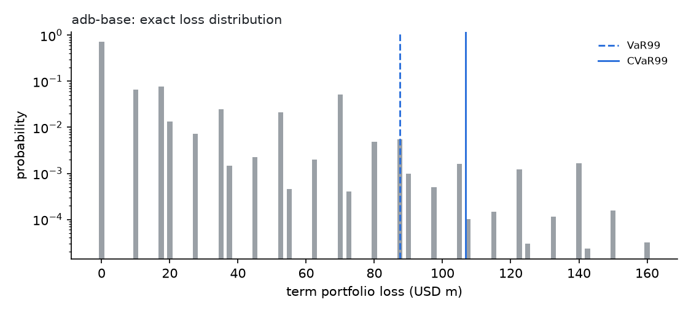
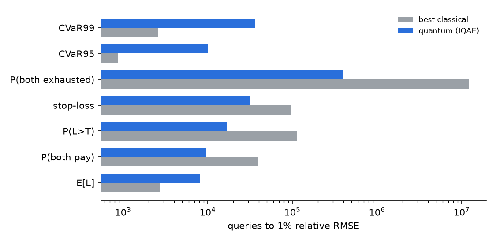

# adb-base

Model: `two_country`. Generated by `adbq run` in 13 s. Costs are queries to 1% relative RMSE (classical: sampled terms; quantum: applications of A with IQAE emulated, noiseless).

Classical costs use exact per-query variances (MC, stratified, the brief's IS; loss-tilted IS for CVaR). Scrambled Sobol is measured empirically (16 repetitions per budget up to 2^18 terms, power-law fit beyond); experiments/accuracy_per_query.py measures it more precisely and is the reference.

| target | value | source | best classical (queries) | quantum (queries) | quantum / classical |
|---|---:|---|---|---:|---:|
| E[L] | USD 10.06m | exact | sobol 2.71e+03 | 8.19e+03 | 0.33x |
| P(both pay) | 0.04414 | exact | sobol 3.99e+04 | 9.55e+03 | 4.17x |
| P(L>T) | 0.01205 | exact | is 1.13e+05 | 1.72e+04 | 6.54x |
| stop-loss | USD 0.28m | exact | sobol 9.62e+04 | 3.15e+04 | 3.05x |
| P(both exhausted) | 3.163e-05 | exact | is 1.21e+07 | 4.01e+05 | 30.10x |
| VaR95 | USD 70.00m | exact | - | 7.3e+03 | - |
| CVaR95 | USD 79.04m | exact | tilt 881 | 1.02e+04 | 0.09x |
| VaR99 | USD 87.50m | exact | - | 4.34e+04 | - |
| CVaR99 | USD 106.70m | exact | tilt 2.58e+03 | 3.6e+04 | 0.07x |

Logical resources per application of A (analytic model, resources.py):

| target | logical qubits | Toffoli | T count |
|---|---:|---:|---:|
| E[L] | 52 | 60 | 21,040 |
| P(both pay) | 52 | 61 | 8,244 |
| P(L>T) | 52 | 68 | 8,272 |
| stop-loss | 52 | 67 | 21,068 |
| P(both exhausted) | 52 | 61 | 8,244 |

Ratio above 1: the quantum route needs fewer queries. A query is not a unit of time; one quantum query is a fault-tolerant circuit (see the T count). VaR rows use certified bisection (no classical column); CVaR uses accuracy-matched bisection plus IQAE.

