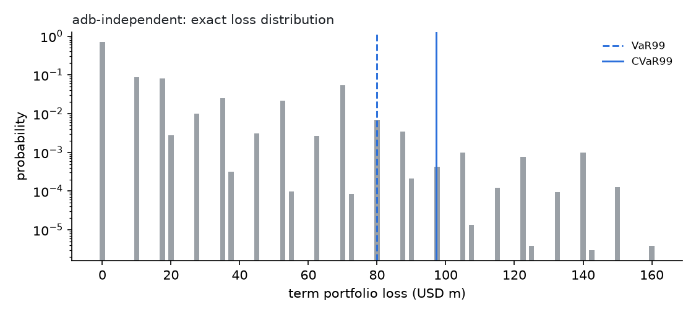
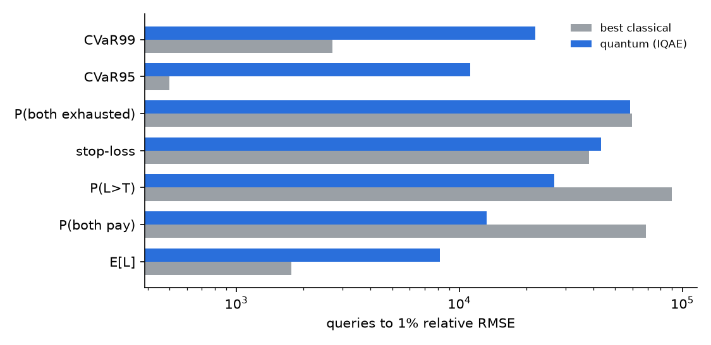

# adb-independent

Model: `two_country`. Generated by `adbq run` in 26 s. Costs are queries to 1% relative RMSE (classical: sampled terms; quantum: applications of A with IQAE emulated, noiseless).

Classical costs use exact per-query variances (MC, stratified, the brief's IS, and a loss-tilted IS tuned per target, `tilt`). For P(both exhausted) both sides condition on the independent rain triggers (`cond_tilt`; conditioned IQAE). Scrambled Sobol is measured empirically (16 repetitions per budget up to 2^18 terms, power-law fit beyond); experiments/accuracy_per_query.py measures it more precisely and is the reference.

| target | value | source | best classical (queries) | quantum (queries) | best classical / quantum |
|---|---:|---|---|---:|---:|
| E[L] | USD 10.06m | exact | sobol 1.77e+03 | 8.19e+03 | 0.22x |
| P(both pay) | 0.02716 | exact | sobol 6.87e+04 | 1.32e+04 | 5.20x |
| P(L>T) | 0.007186 | exact | tilt 8.96e+04 | 2.67e+04 | 3.36x |
| stop-loss | USD 0.17m | exact | tilt 3.81e+04 | 4.33e+04 | 0.88x |
| P(both exhausted) | 3.924e-06 | exact | cond_tilt 5.96e+04 | 5.83e+04 | 1.02x |
| VaR95 | USD 70.00m | exact | - | 7.14e+03 | - |
| CVaR95 | USD 76.23m | exact | tilt 502 | 1.12e+04 | 0.05x |
| VaR99 | USD 80.00m | exact | - | 2.34e+04 | - |
| CVaR99 | USD 97.13m | exact | tilt 2.69e+03 | 2.19e+04 | 0.12x |

Logical resources per application of A (analytic model, resources.py):

| target | logical qubits | Toffoli | T count |
|---|---:|---:|---:|
| E[L] | 52 | 60 | 21,040 |
| P(both pay) | 52 | 61 | 8,244 |
| P(L>T) | 52 | 68 | 8,272 |
| stop-loss | 52 | 67 | 21,068 |
| P(both exhausted) | 52 | 61 | 8,244 |

Ratio = best classical queries / quantum queries; above 1, the quantum route needs fewer queries. A query is not a unit of time; one quantum query is a fault-tolerant circuit (see the T count). VaR rows use certified bisection (no classical column); CVaR uses accuracy-matched bisection plus IQAE.

