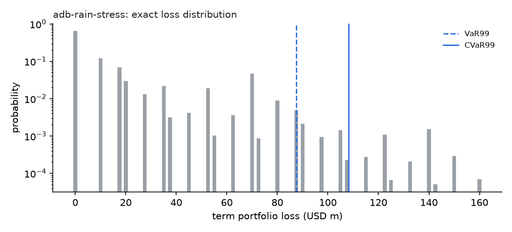
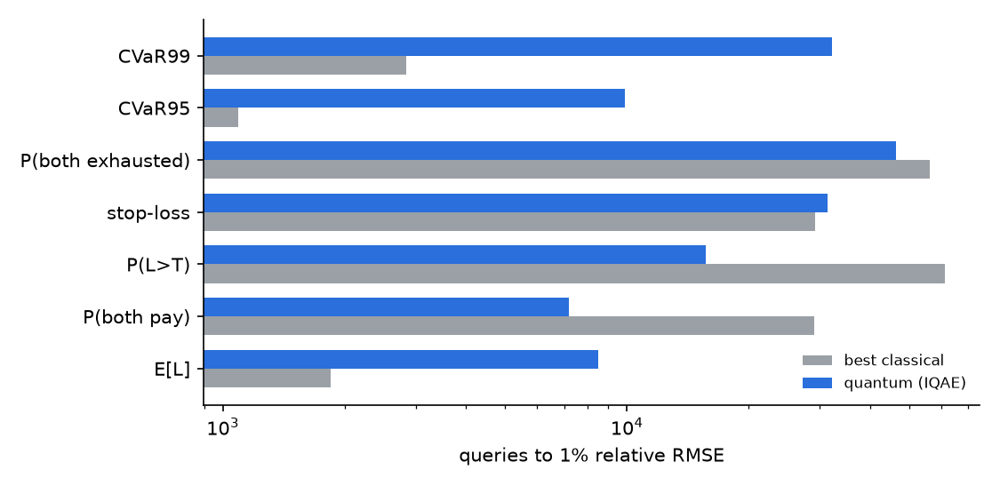

# adb-rain-stress

Model: `two_country`. Generated by `adbq run` in 27 s. Costs are queries to 1% relative RMSE (classical: sampled terms; quantum: applications of A with IQAE emulated, noiseless).

Classical costs use exact per-query variances (MC, stratified, the brief's IS, and a loss-tilted IS tuned per target, `tilt`). For P(both exhausted) both sides condition on the independent rain triggers (`cond_tilt`; conditioned IQAE). Scrambled Sobol is measured empirically (16 repetitions per budget up to 2^18 terms, power-law fit beyond); experiments/accuracy_per_query.py measures it more precisely and is the reference.

| target | value | source | best classical (queries) | quantum (queries) | quantum / classical |
|---|---:|---|---|---:|---:|
| E[L] | USD 11.17m | exact | sobol 1.84e+03 | 8.5e+03 | 0.22x |
| P(both pay) | 0.07046 | exact | sobol 2.91e+04 | 7.18e+03 | 4.04x |
| P(L>T) | 0.01322 | exact | tilt 6.11e+04 | 1.56e+04 | 3.91x |
| stop-loss | USD 0.31m | exact | tilt 2.93e+04 | 3.14e+04 | 0.93x |
| P(both exhausted) | 6.925e-05 | exact | cond_tilt 5.62e+04 | 4.64e+04 | 1.21x |
| VaR95 | USD 70.00m | exact | - | 8.42e+03 | - |
| CVaR95 | USD 80.59m | exact | tilt 1.09e+03 | 9.9e+03 | 0.11x |
| VaR99 | USD 87.50m | exact | - | 4.21e+04 | - |
| CVaR99 | USD 108.22m | exact | tilt 2.85e+03 | 3.22e+04 | 0.09x |

Logical resources per application of A (analytic model, resources.py):

| target | logical qubits | Toffoli | T count |
|---|---:|---:|---:|
| E[L] | 52 | 60 | 21,040 |
| P(both pay) | 52 | 61 | 8,244 |
| P(L>T) | 52 | 68 | 8,272 |
| stop-loss | 52 | 67 | 21,068 |
| P(both exhausted) | 52 | 61 | 8,244 |

Ratio above 1: the quantum route needs fewer queries. A query is not a unit of time; one quantum query is a fault-tolerant circuit (see the T count). VaR rows use certified bisection (no classical column); CVaR uses accuracy-matched bisection plus IQAE.

