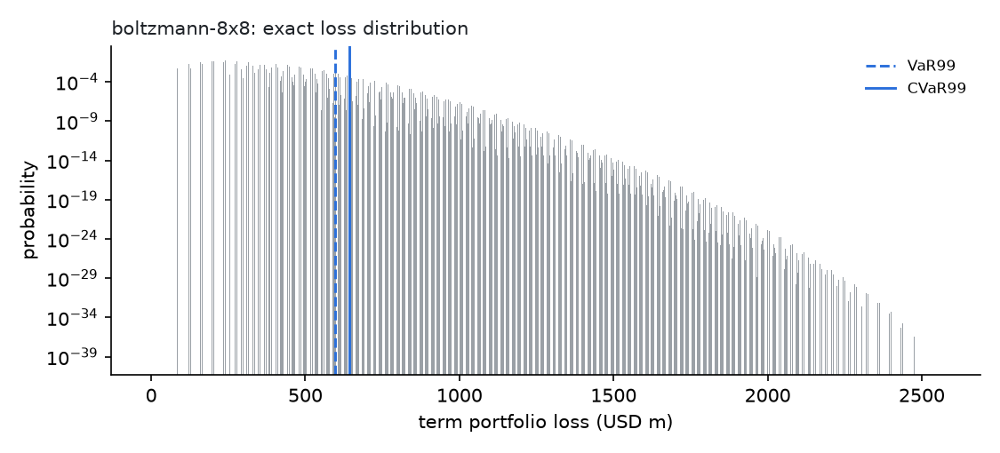

# boltzmann-8x8

Model: `grid_boltzmann`. Generated by `adbq run` in 0 s. Costs are queries to 1% relative RMSE (classical: sampled terms; quantum: applications of A with IQAE emulated, noiseless).

Boltzmann (Ising) trigger law: exact by transfer matrix; 'iid_mc' assumes perfect i.i.d. draws, which an MCMC sampler does not deliver. QeMCMC comparisons: results/qmcmc_exact.md, results/qmcmc_chains.md. No QAE loader is built for this law.

| target | value | source | best classical (queries) | quantum (queries) | quantum / classical |
|---|---:|---|---|---:|---:|
| E[L] | USD 288.18m | exact | iid_mc 1.6e+03 | - | - |
| P(L>T) | 0.004689 | exact | iid_mc 2.12e+06 | - | - |
| VaR95 | USD 485.00m | exact | - | - | - |
| CVaR95 | USD 552.72m | exact | - | - | - |
| VaR99 | USD 597.50m | exact | - | - | - |
| CVaR99 | USD 644.06m | exact | - | - | - |

Ratio above 1: the quantum route needs fewer queries. A query is not a unit of time; one quantum query is a fault-tolerant circuit (see the T count). VaR rows use certified bisection (no classical column); CVaR uses accuracy-matched bisection plus IQAE.

