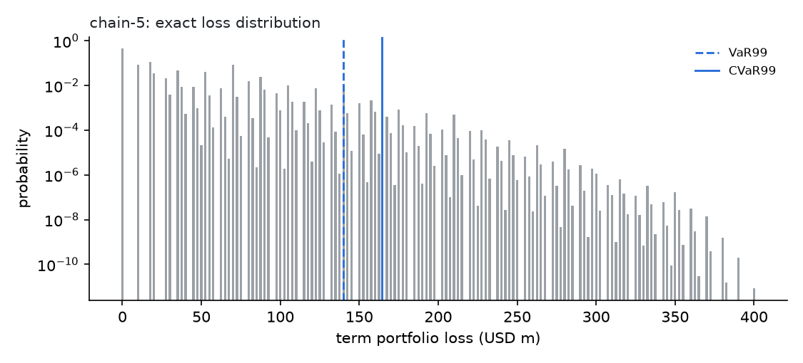
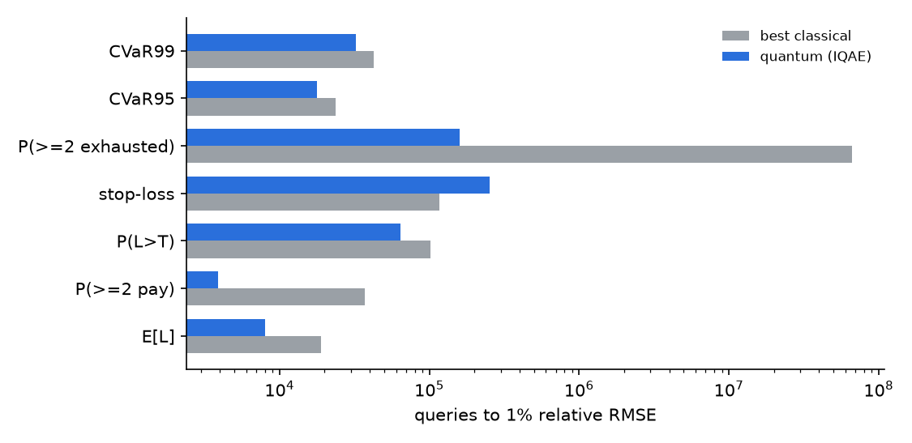

# chain-5

Model: `chain`. Generated by `adbq run` in 2 s. Costs are queries to 1% relative RMSE (classical: sampled terms; quantum: applications of A with IQAE emulated, noiseless).

Chain: classical costs are MC (exact variance) and, for portfolio-loss targets, exponential-tilt and cross-entropy IS on the source model (pilot/adaptation cost included). The count targets P(>=2 pay) and P(>=2 exhausted) have MC only, so their ratios overstate the quantum gain; RQMC is not run here (results/grid_qae.md).

| target | value | source | best classical (queries) | quantum (queries) | best classical / quantum |
|---|---:|---|---|---:|---:|
| E[L] | USD 25.45m | exact | mc 1.89e+04 | 8.02e+03 | 2.36x |
| P(>=2 pay) | 0.2119 | exact | mc 3.72e+04 (MC only) | 3.9e+03 | 9.53x |
| P(L>T) | 0.00101 | exact | ce 1.02e+05 | 6.4e+04 | 1.59x |
| stop-loss | USD 0.02m | exact | tilt 1.16e+05 | 2.53e+05 | 0.46x |
| P(>=2 exhausted) | 0.0001496 | exact | mc 6.68e+07 (MC only) | 1.6e+05 | 418.71x |
| VaR95 | USD 90.00m | exact | - | 6.02e+04 | - |
| CVaR95 | USD 124.18m | exact | mc 2.38e+04 (MC only) | 1.77e+04 | 1.34x |
| VaR99 | USD 140.00m | exact | - | 4.76e+04 | - |
| CVaR99 | USD 164.30m | exact | mc 4.26e+04 (MC only) | 3.22e+04 | 1.32x |

Logical resources per application of A (analytic model, resources.py):

| target | logical qubits | Toffoli | T count |
|---|---:|---:|---:|
| E[L] | 99 | 160 | 55,840 |
| P(>=2 pay) | 99 | 161 | 30,244 |
| P(L>T) | 99 | 169 | 30,276 |
| stop-loss | 99 | 168 | 55,872 |
| P(>=2 exhausted) | 99 | 161 | 30,244 |

Ratio = best classical queries / quantum queries; above 1, the quantum route needs fewer queries. A query is not a unit of time; one quantum query is a fault-tolerant circuit (see the T count). VaR rows use certified bisection (no classical column); CVaR uses accuracy-matched bisection plus IQAE.

