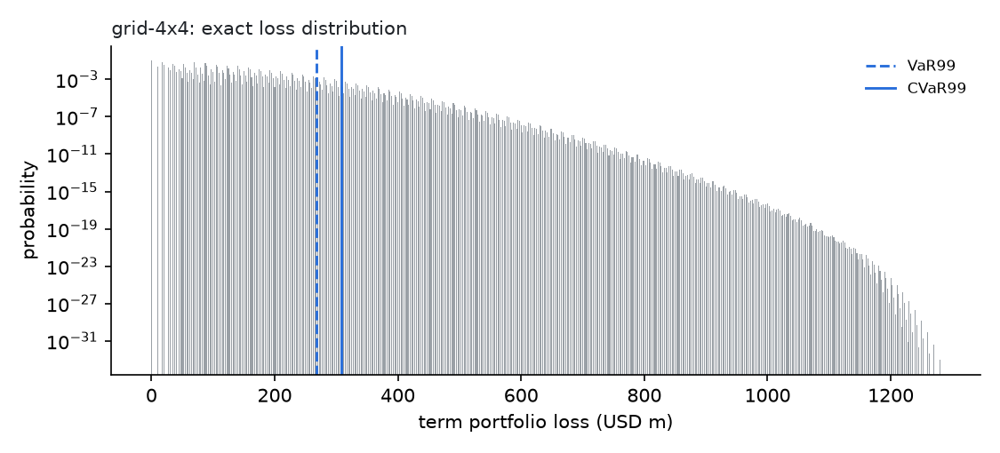
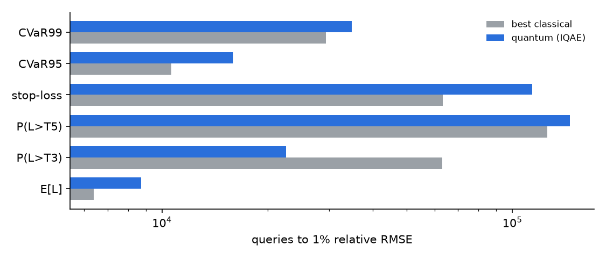

# grid-4x4

Model: `grid_sources`. Generated by `adbq run` in 39 s. Costs are queries to 1% relative RMSE (classical: sampled terms; quantum: applications of A with IQAE emulated, noiseless).

Grid source model: thresholds T3, T5 = E[L] + 3 / 5 sd (exact moments); 'P(L>T)' means T3. Beyond 4 rows the exact sweep is out of reach and references are tilted-IS estimates.

| target | value | source | best classical (queries) | quantum (queries) | quantum / classical |
|---|---:|---|---|---:|---:|
| E[L] | USD 80.51m | exact | mc 6.39e+03 | 8.72e+03 | 0.73x |
| P(L>T3) | 0.009104 | exact | ce 6.31e+04 | 2.26e+04 | 2.79x |
| P(L>T5) | 0.0002141 | exact | ce 1.26e+05 | 1.46e+05 | 0.86x |
| stop-loss | USD 0.33m | exact | ce 6.33e+04 | 1.14e+05 | 0.56x |
| VaR95 | USD 202.50m | exact | - | 4.19e+05 | - |
| CVaR95 | USD 244.70m | exact | mc 1.06e+04 (MC only) | 1.6e+04 | 0.67x |
| VaR99 | USD 267.50m | exact | - | 6.35e+06 | - |
| CVaR99 | USD 307.61m | exact | mc 2.94e+04 (MC only) | 3.48e+04 | 0.85x |

Logical resources per application of A (analytic model, resources.py):

| target | logical qubits | Toffoli | T count |
|---|---:|---:|---:|
| E[L] | 331 | 704 | 271,616 |
| P(L>T3) | 331 | 715 | 169,260 |
| P(L>T5) | 331 | 715 | 169,260 |
| stop-loss | 331 | 714 | 271,656 |

Ratio above 1: the quantum route needs fewer queries. A query is not a unit of time; one quantum query is a fault-tolerant circuit (see the T count). VaR rows use certified bisection (no classical column); CVaR uses accuracy-matched bisection plus IQAE.

